## The question behind this session

::: {.question}
When an assistant produces plausible R code, what evidence lets you decide
whether it answers the statistical question?
:::


## Learning goals

1. Explain how Positron uses R and locate familiar RStudio tools in its panels.
2. Distinguish models, applications, context, and agent tools.
3. Choose completion or an explicit request for the intended work.
4. Inspect and test a suggestion before relying on it.
5. Apply the privacy and disclosure rules.


## A 90-minute route

| Block | Purpose | Minutes |
|---|---|---:|
| Positron orientation | Tour the panels and find familiar R tools | 20 |
| 1. Understand | LLMs, applications, interactions, and agent tools | 10 |
| 2. Set up and 3. Work | Connect a provider and work through the SBP examples | 25 |
| 4. Verify | Diagnose and repair the week-12 SBP denominator | 20 |
| Verification and policy | Apply checks, privacy rules, and disclosure | 5 |
| Synthesis and exit check | Explain the workflow and the evidence | 10 |


## R, RStudio, and Positron

| Name | Role in your analysis |
|---|---|
| **R** | The language and interpreter that execute your code |
| **RStudio** | An integrated development environment (IDE) for writing and running code |
| **Positron** | Another IDE, with built-in support for R and Python |
| **Posit** | The company that develops both RStudio and Positron |

Positron uses an installed copy of R. Keep the R installation you already use.


## The same R code in either IDE

```r
x <- c(4, 6, 8, NA)
mean(x, na.rm = TRUE)
# [1] 6
```

- R syntax, functions, and packages carry over.
- Existing `.R` scripts and `.qmd` documents remain ordinary source files.
- Match the R version, package versions, data, and working directory when
  comparing results.

Opening the same file in two IDEs starts separate sessions with separate objects.


## RStudio and Positron side by side

::: {style="text-align: center;"}
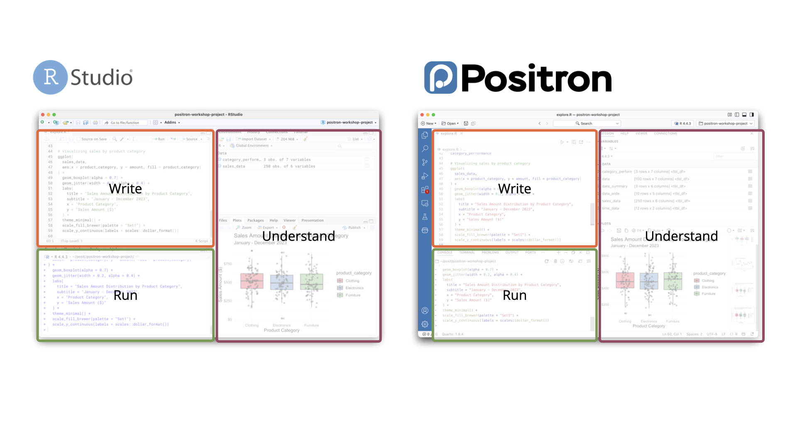{height=510 fig-alt="Official comparison screenshot: RStudio on the left and Positron on the right, with corresponding editor, console, and output regions labeled Write, Run, and Understand."}
:::

::: {.small}
The same workflow: write code, run it, then inspect the result.
Screenshot: [Posit RStudio migration guide](https://positron.posit.co/migrate-rstudio.html).
:::


## A tour of the Positron window

::: {style="text-align: center;"}
{height=510 fig-alt="Official annotated Positron screenshot identifying the Activity Bar on the far left, Primary Side Bar, central Editor, lower Panel with Console and Terminal tabs, and right Secondary Side Bar with Variables and Plots."}
:::

::: {.small}
Screenshot: [Posit layout guide](https://positron.posit.co/layout.html).
Panels can move. Your version, theme, and layout may look different.
:::


## Primary sidebar: files and open editors {.panel-tour}

:::: {.columns}
::: {.column width="32%"}
<div class="tour-crop crop-explorer" role="img" aria-label="Enlarged crop of the official screenshot showing Explorer, Open Editors, and the project file tree."></div>
:::
::: {.column width="68%"}

With **Explorer** selected in the Activity Bar:

- **Open Editors** lists files currently open in tabs.
- **Project tree** lists folders and files in the workspace, including files
  that are not open.
- Expand a folder, then select a file to open it in the Editor.
- Create or rename files through the Explorer controls or context menu.

**Try it:** find your copied lab under `work/session09/` and open it.

The file lives on disk. Opening its tab does not execute its R code.

:::
::::

::: {.tour-credit}
Detail from the [Posit layout screenshot](https://positron.posit.co/layout.html).
:::


## Primary sidebar: outline, history, and Git {.panel-tour}

<div class="tour-crop crop-outline" role="img" aria-label="Enlarged screenshot detail showing the collapsed Outline and Timeline sections at the bottom of Explorer."></div>

| Tool | What it shows | Example use |
|---|---|---|
| **Outline** | Structure of the active file, such as headings or functions | Jump to a report section |
| **Timeline** | History of the selected file, including Git commits and local saves when available | Compare an earlier version |
| **Source Control** | Changed and staged files in a Git repository | Review a diff and commit |
| **Search** | Matches across workspace files | Find every use of `n_observed` |

**Outline and Timeline are collapsed in this screenshot.** Expand their headings.
Choose Source Control or Search in the Activity Bar to switch sidebar views.

::: {.tour-credit}
Detail from [Posit](https://positron.posit.co/layout.html).
[Outline and Timeline reference](https://code.visualstudio.com/docs/editing/getting-started/userinterface).
:::


## Editor: source files and document controls {.panel-tour}

:::: {.columns}
::: {.column width="52%"}
<div class="tour-crop crop-editor" role="img" aria-label="Enlarged central Editor showing document tabs, Quarto Preview and Render on Save controls, Source and Visual modes, prose, and an R code chunk."></div>
:::
::: {.column width="48%"}

- **Tabs** switch between open files.
- A **`.R` script** contains R code and comments.
- A **`.qmd` document** combines prose, headings, and code chunks.
- **Source / Visual** changes how you edit a Quarto document.
- **Run controls** execute code. **Preview** builds a report preview.

The toolbar depends on the file type. A plain R script has no Quarto Visual mode.

:::
::::

**Also in this area:** Data Explorer tabs and Git comparisons can open beside
your source files.

::: {.tour-credit}
Detail from [Posit](https://positron.posit.co/layout.html).
[Quarto in Positron](https://positron.posit.co/quarto.html).
:::


## Lower panel: Console, Terminal, and messages {.panel-tour}

:::: {.columns}
::: {.column width="52%"}
<div class="tour-crop crop-console" role="img" aria-label="Enlarged lower Panel showing Console, Terminal, Problems, Output, and Ports tabs, with an R Console active."></div>
:::
::: {.column width="48%"}

- **Console:** run R expressions and read results, warnings, or errors.
- **Terminal:** run shell commands such as `git status`.
- **Problems:** inspect diagnostics reported by language tools.
- **Output:** inspect logs from extensions and other tools.
- **Ports:** manage access to services in supported remote workflows.

**Try it:** run `1 + 1` in the R Console. The result should be `2`.

:::
::::

::: {.tour-credit}
Detail from the [Posit layout screenshot](https://positron.posit.co/layout.html).
:::


## Secondary sidebar: Variables and Plots {.panel-tour}

:::: {.columns}
::: {.column width="40%"}
<div class="tour-crop crop-variables" role="img" aria-label="Enlarged Variables area showing data frames, their dimensions, and an expanded object."></div>
<div class="tour-crop crop-plot" role="img" aria-label="Detail of the Plots area showing its toolbar and a scatterplot from the same R session."></div>
:::
::: {.column width="60%"}

The **Session** view groups the active interpreter's results.

- **Variables:** objects currently in memory, including vectors, lists, and
  data frames. Expand an object to inspect it.
- **Data frame entries:** show dimensions. Open one in **Data Explorer** to
  inspect its rows and columns.
- **Plots:** figures created by your code, with controls to browse and save them.

**Try it:** after running `demo <- data.frame(x = 1:3)`, find `demo` in Variables.

Explorer shows files on disk. Variables shows objects in the current session.

:::
::::

::: {.tour-credit}
Details from [Posit](https://positron.posit.co/layout.html).
[Variables](https://positron.posit.co/variables-pane.html) and [Data Explorer](https://positron.posit.co/data-explorer.html).
:::


## Secondary sidebar: Help, Viewer, and more {.panel-tour}

<div class="tour-crop crop-secondary-tabs" role="img" aria-label="Enlarged secondary sidebar tab strip showing Session, Connections, Help, and Viewer."></div>

| View | What it is for | Example |
|---|---|---|
| **Help** | Function and package documentation | Run `?mean` in R |
| **Viewer** | Web content such as a Shiny app or HTML widget | Inspect an interactive display |
| **Connections** | Supported database connections and their tables | Browse a connected database |
| **History** | Previously executed commands | Find an earlier command |

**History is not visible in this screenshot's tab strip.** Available tabs and
their locations vary with the version and layout.

Command history records what you ran. Git history records committed file changes.

::: {.tour-credit}
Detail and view descriptions: [Posit layout guide](https://positron.posit.co/layout.html).
:::


## The main regions and their jobs

| Region | What you do there |
|---|---|
| **Activity Bar** | Switch to Explorer, Search, Source Control, or Extensions |
| **Primary Side Bar** | Browse project files or use the selected tool |
| **Editor** | Write and save your script or Quarto document |
| **Panel** | Run R in the Console or shell commands in the Terminal |
| **Secondary Side Bar** | Inspect Variables and Plots, or open Help and Viewer |

**Console:** `mean(x)` runs in R. **Terminal:** `git status` runs in the shell.


## Familiar RStudio tools in Positron

| In RStudio | In Positron | Use it to... |
|---|---|---|
| Source | Editor | Save the analysis as code |
| Console | Console with an R session | Execute R and read messages |
| Environment | Variables | Inspect objects in the active session |
| Data Viewer | Data Explorer, e.g. `View(df)` | Inspect a data frame |
| Plots / Help / Viewer | Plots / Help / Viewer | Inspect figures, documentation, HTML |
| Files / Git | Explorer / Source Control | Browse files and review changes |


## What feels different from RStudio

- **Editor foundation:** Positron uses Code OSS, the foundation of VS Code,
  with extensions and flexible layouts.
- **Language sessions:** select and manage R or Python interpreters within
  the workspace. RStudio's workflow centers on R, with Python integration.
- **Commands:** the Command Palette is a frequent starting point for actions
  that you may know as RStudio buttons.
- **Projects:** open a folder as a Positron workspace. Keep the `.Rproj` file
  for RStudio, but do not expect its settings to transfer automatically.


## Positron's VS Code foundation

**Positron builds on Code OSS, the open-source core of Visual Studio Code.**
Posit adds the R/Python Console, Variables, Plots, and Data Explorer.

- VS Code serves a much broader developer community across many languages.
- Its extension ecosystem offers a wide choice of AI assistants and advanced
  tools for debugging, Git, databases, testing, and remote development.
- Positron can reuse many compatible extensions while providing a ready-made
  environment for data science.

**Why this matters:** a larger ecosystem means more options for extending your
workflow. Availability and compatibility still depend on the specific tool.


## The VS Code extension marketplace

::: {style="text-align: center;"}
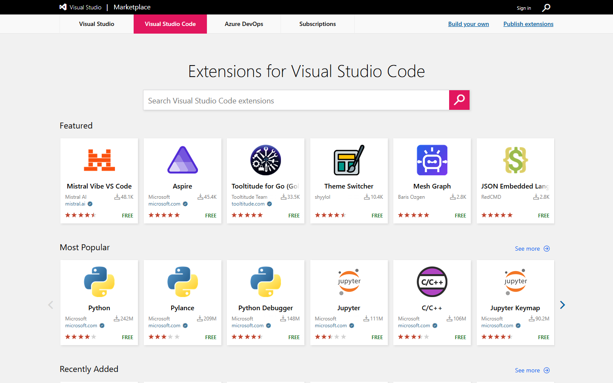{height=500 fig-alt="Microsoft Visual Studio Marketplace with the Visual Studio Code tab selected, extension search box, Featured extensions including an AI tool, and Most Popular extensions."}
:::

::: {.small}
[Browse Microsoft's VS Code Marketplace](https://marketplace.visualstudio.com/vscode).
This is the catalog used by Microsoft's VS Code.
:::


## The Open VSX extension catalog

::: {style="text-align: center;"}
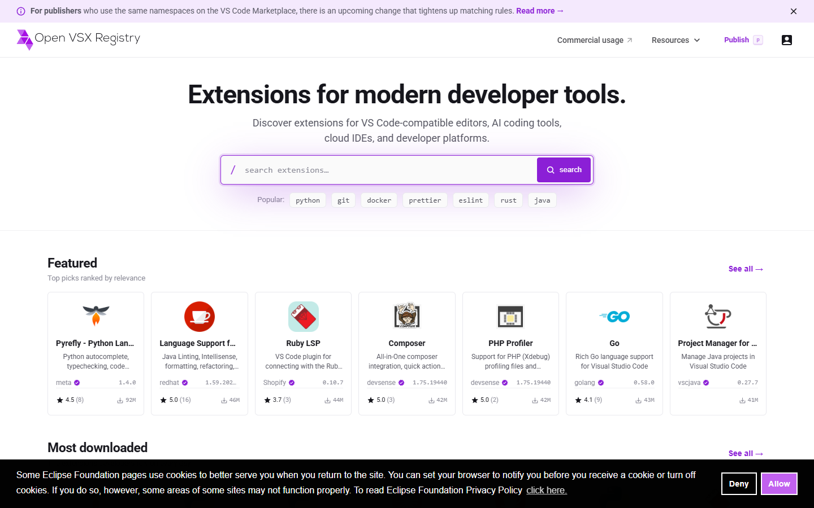{height=500 fig-alt="Open VSX Registry with its extension search box and listings for VS Code-compatible editors."}
:::

::: {.small}
[Browse Open VSX](https://open-vsx.org/). Positron's default gallery uses this
catalog, served through Posit Public Package Manager.
:::


## Four workflow differences to try

Your R code carries over. These conveniences change how you work with it.

| Feature | What to try |
|---|---|
| **Script cells** | Run a named section of a plain R script |
| **Multiple sessions** | Switch between independent R or Python sessions |
| **Data Explorer** | Inspect a file or data frame with column summaries |
| **Air formatting** | Format R code and choose project-level settings |

RStudio has comparable features. Here we focus on Positron's controls and defaults.


## Scripts can use code cells

```r
# %% Create and inspect (small synthetic example)
visit <- data.frame(sbp0 = c(130, 145, 150),
                    sbp12 = c(125, 140, 142))
str(visit)

# %% Plot the visits
plot(visit$sbp0, visit$sbp12)
```

Use **Run Cell**, **Run Above**, or **Run Next** above a cell delimiter.
Output appears in the current Console session.

The file stays an ordinary `.R` script. Cells share session objects, so run
from the top when checking reproducibility.

::: {.source-credit}
[Positron code cells](https://positron.posit.co/code-cells.html)
:::


## Multiple interpreters in one workspace

Positron can keep several **independent R and Python sessions** running.
Use the interpreter picker to start or switch sessions.

| Example | What it demonstrates |
|---|---|
| In R session A, run `x <- 10` | A now contains `x` |
| Start a fresh R session B and run `exists("x")` | B returns `FALSE` |
| Switch back to A and run `x` | A still returns `10` |

**Before running a cell, check the selected session.** Variables and Plots
follow the active interpreter. Sessions can use different R versions or libraries.

::: {.source-credit}
[Managing interpreters](https://positron.posit.co/managing-interpreters.html)
:::


## Data Explorer: a file view or a session object

RStudio users know `View(df)`. Positron also opens data files directly and
provides a column-summary panel beside its grid.

| Starting point | What you inspect |
|---|---|
| Open `sbp-demo.csv` from Explorer | The saved file, without first creating an R object |
| Run `View(trial)` | The data frame currently in the selected R session |
| Use column summaries and filters | Distributions, missingness, and a temporary subset |

**A filtered view does not change the analysis data.** Put inclusion rules
and missing-value handling in the saved R code.

::: {.source-credit}
[Data Explorer](https://positron.posit.co/data-explorer.html)
:::


## Air formatting and workspace settings

Positron includes **Air**, an R code formatter. Run **Format Document**
from the Command Palette to standardize spacing and layout.

```r
# Before
mean(visit$sbp12,na.rm=TRUE)
# After formatting
mean(visit$sbp12, na.rm = TRUE)
```

**Format on save is opt-in.** Workspace settings apply to the current project
and are stored in `.vscode/settings.json`. User settings apply more broadly.

Formatting improves readability. It does not check the statistical analysis.

::: {.source-credit}
[Air in Positron](https://positron.posit.co/guide-r-air.html)
:::


## AI-assisted coding {.section-divider}

**Four parts, one workflow**

1. **Understand:** how an LLM and a coding application work together.
2. **Set up:** choose a provider, mode, and permitted tools.
3. **Work:** try completion, then make explicit requests using SBP.
4. **Verify:** inspect the code, check the statistics, and disclose assistance.


## 1. Understand: the LLM and the application

**The AI model is usually a large language model (LLM), sometimes with image capabilities.** It uses supplied context to generate responses, code, or tool requests.

**The coding application lets you interact with the LLM.** It gathers context, sends requests, displays responses, and can use tools to act on those responses.

**R executes the R code.** The LLM can propose a calculation without actually running it.

The same LLM can behave differently in applications with different context, tools, and permissions.

::: {.source-credit}
[Models, applications, and tools in an agent workflow](https://docs.cloud.google.com/gemini/docs/codeassist/agent-mode)
:::


## What happens between typing and a result?

| Step | Who does it? |
|---|---|
| You type, select code, or send a message | **You** provide an action or explicit request |
| Relevant code and instructions become model input | **The application** constructs a request |
| A continuation, explanation, edit, or tool request is generated | **The LLM** produces a response |
| Suggested text appears or a permitted tool runs | **The application** presents or acts on the response |

**You do not always type a question. The application can construct a request from what you type, select, or change.**


## Five interactions you may encounter

| Interaction | What you do | What the application presents or does |
|---|---|---|
| **Inline completion** | Type code | Suggested continuation at the cursor |
| **Next-edit suggestion** | Change code | A predicted related edit |
| **Chat / explanation** | Ask a question | An answer or proposed code |
| **Directed edit / inline chat** | Request a specific change | An edit for review |
| **Agent workflow** | Request an outcome | Connected tool actions and results |

The first two can start **without an explicit user request**. The last three respond to a request you express.

::: {.source-credit}
[VS Code AI workflows](https://code.visualstudio.com/docs/agents/overview) ·
[Completion and next-edit suggestions](https://code.visualstudio.com/docs/editing/ai-powered-suggestions)
:::


## Predictions: what might the application ask the LLM?

| Your action | Conceptual model request | Possible proposal |
|---|---|---|
| Type `write.csv(` | “Given this code, what continuation is likely?” | An object, file path, and arguments |
| Change `T1` to `T001` | “Given this edit and the nearby code, what related edit might follow?” | Change `T2` to `T002` |

The application displays the proposal for you to accept or dismiss.

**A predicted edit is a guess about intent.** Changing `T1` does not establish that `T2` should change too.

::: {.source-credit}
[How inline suggestions use context](https://docs.github.com/en/copilot/responsible-use/inline-suggestions)
:::


## Explicit requests: answer, edit, or act?

| Your request | What you want back | Application behavior to check |
|---|---|---|
| “Why does this plot not appear?” | An explanation | Does it only reply, or also change code? |
| “Add arm colors to this plot.” | A focused edit | Which lines changed? |
| “Create the outputs and check them.” | Completed work with evidence | Which files and commands did it use? |

**Inline chat is a place to make an explicit editing request.** It differs from predicted inline completion.


## Context: what information does AI receive?

**Context is the information the application supplies for a model response.**
There are several ways information enters it:

| Route | Example | What to check |
|---|---|---|
| **Automatic context** | Conversation, editor context, session metadata | Which features and settings are enabled? |
| **You supply it** | Paste an error, attach a plot, reference a file | Was it included, and was it truncated? |
| **A tool retrieves it** | Read a file, search code, inspect console output | Did a tool actually return the information? |

**Accessible is not the same as already read.** An open tab or a named path
does not prove the model has received the whole file.

::: {.source-credit}
[Posit context](https://assistant.posit.co/docs/features/context-management/) ·
[Attachments and file references](https://assistant.posit.co/docs/features/chat-features/)
:::


## What Posit Assistant includes automatically

With an R session connected and **session context enabled**, Posit Assistant
automatically receives:

- The language and version.
- Variable **names and types**, such as `trial` being a data frame.
- **Not the variables' values** through this automatic session summary.

Use the **eye icon** to toggle session context. To supply specific code or data,
use `@` file references, attachments, or paste the relevant output.

Values can enter later through file reads, supplied output, or permitted R execution.

::: {.source-credit}
[Session context and its toggle](https://assistant.posit.co/docs/features/context-management/) ·
[Explicit file context](https://assistant.posit.co/docs/features/chat-features/)
:::


## Ask and agent work: different access to actions

**Chat is an interface. Ask is a mode. The LLM is the model.**
Changing mode need not change the selected model.

| In Posit Assistant | Ask mode | Regular agent work |
|---|---|---|
| Receive enabled session metadata (names/types) | Yes | Yes |
| Read/search files; inspect console history or plots | Available | Available |
| Edit files or execute R/Python | Blocked | Available, subject to permissions |

Ask can gather information and explain it. Agent work can also **change code,
run it, and use the new result** to continue.

::: {.source-credit}
[Ask mode capabilities](https://assistant.posit.co/docs/features/ask-mode/)
:::


## SBP example: what does the answer rely on?

Suppose you ask, **“How many patients have missing week-12 SBP?”**

| Information available | What it establishes |
|---|---|
| Session summary says `trial` is a data frame | The object exists, not the missing-value count |
| The CSV is attached or read with a file tool | The saved values can be inspected, even in Ask mode |
| You run the check below and paste the output | Evidence from your current R object |
| A permitted execution tool runs the check | Evidence returned through the agent workflow |

```r
sum(is.na(trial$sbp_12))
```

Ask which data source and observed result support the answer.


## An agent works through a feedback loop

**An agent combines an LLM with tools and a feedback loop to pursue a task.**

For “Fix the report and rerun it,” the workflow might be:

1. Read the report source and relevant input files.
2. Propose and apply a code change.
3. Run the report through an execution tool.
4. Read the error message or inspect the output.
5. Revise the code and check again.

The LLM proposes actions. **The application runs permitted tools and returns their observations to the LLM.**

::: {.source-credit}
[Agent action-and-evaluation cycle](https://docs.cloud.google.com/gemini/docs/codeassist/agent-mode)
:::


## Where does the code run?

| | Local execution | Cloud execution |
|---|---|---|
| **Workspace** | Files on your computer or connected host | A separately configured remote workspace |
| **Software** | The available local R and packages | R and packages must be available there |
| **Data access** | Depends on local paths and permissions | Depends on files and connections provided there |
| **Typical workflow** | Interactive work beside your editor | A task can continue independently of your laptop |

**Local execution does not necessarily mean a local AI model.** Code may run locally while permitted context goes to a remote model service.

::: {.source-credit}
[Cloud environments](https://learn.chatgpt.com/docs/environments/cloud-environments) ·
[Posit Assistant providers](https://assistant.posit.co/docs/getting-started/providers/)
:::


## Examples: AI inside a coding environment

| Product | What it brings together |
|---|---|
| **GitHub Copilot** | Suggestions, chat, focused edits, and agent workflows in supported clients |
| **Cursor** | An editor and agent workflows with project search, file edits, commands, and change review |
| **Posit Assistant in Positron** | Assistance integrated with an R/Python workspace and session context |

One product can offer several interactions. **Features depend on the client, configuration, and account.**

::: {.source-credit}
[Copilot in VS Code](https://code.visualstudio.com/docs/agents/overview) ·
[Cursor](https://prod.cursor.com/help/ai-features/agent) ·
[Posit Assistant](https://positron.posit.co/assistant.html)
:::


## Examples: agents across several interfaces

| Product | Ways to work with it |
|---|---|
| **Claude Code** | Terminal, IDE, desktop, and browser interfaces for working on a codebase |
| **OpenAI Codex** | Desktop, IDE, terminal, and cloud workflows for project tasks |
| **Google Antigravity** | Agent tools across desktop, editor, and terminal interfaces, including browser interaction |

An agent can appear in a sidebar, terminal, or separate app. **Its interface does not tell you everything it can access or do.**

::: {.source-credit}
[Claude Code](https://code.claude.com/docs/en/overview) ·
[Codex](https://learn.chatgpt.com/docs/codex/ide) ·
[Antigravity](https://www.antigravity.google/docs/overview?tab=ide)
:::


## 2. Set up the class workflow {.section-divider}

**Apply the concepts to one example configuration.**

1. Identify the application, provider, and R interpreter.
2. Connect the provider and find the assistant panel.
3. Choose whether to discuss, plan, or implement.
4. Check tool permissions before editing or execution.

Copilot is our example provider. Other AI tools are permitted, and the lab has an AI-free route.


## The names you will see

| Name | Role in today's demonstration |
|---|---|
| **Positron** | The workspace containing your editor, Console, and panels |
| **R** | Runs the R code and calculates the result |
| **GitHub Copilot** | Our example AI service, including inline suggestions |
| **Posit Assistant** | The panel where we discuss code and request agent work |

A **provider** supplies access to AI models. Posit Assistant can connect to
different providers, including GitHub Copilot.


## GitHub Copilot: our worked example

**GitHub Copilot is GitHub's AI coding assistant.**

- It can suggest code, answer questions, and help revise existing code.
- It works in supported editors and other GitHub workflows.
- In Positron, we will use its **inline code suggestions**.
- Access requires a GitHub account with Copilot enabled.

**Copilot is one example.** Other AI tools may be used under the same course
rules. No AI tool is required for the lab.


## An AI chat interface inside Positron {.ai-intro}

::: {style="text-align: center;"}
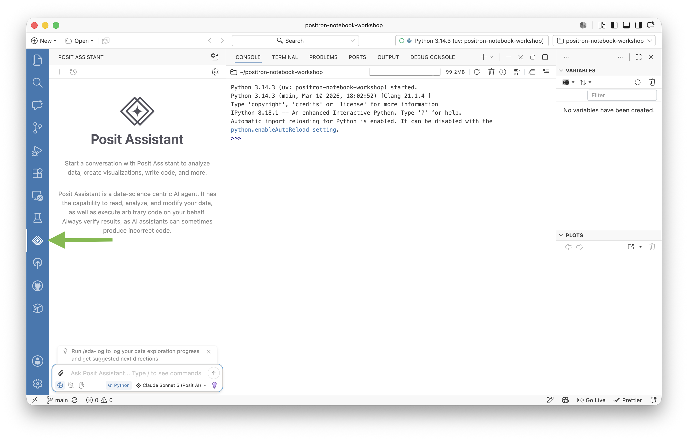{height=440 fig-alt="Official Positron screenshot with Posit Assistant open in the left sidebar, a Python Console in the center, and Variables and Plots on the right."}
:::

**Posit Assistant** is Posit's chat interface. It connects to a provider you select.
**GitHub Copilot** is one available provider, with its own coding features.

::: {.source-credit}
[Posit tutorial screenshot](https://positron.posit.co/tutorial-ai-notebooks.html).
This Python example shows the interface; our exercise uses R.
:::


## Connect GitHub Copilot in Positron

1. Open the Command Palette: **Ctrl+Shift+P** on Windows/Linux,
   **Cmd+Shift+P** on macOS.
2. Run this command:

```text
Authentication: Configure Language Model Providers
```

3. Choose **GitHub Copilot**, then sign in through the browser.
4. Return to Positron. We will try completion, then Posit Assistant.

Use an account with Copilot access. If setup is unavailable, the supplied
candidate code supports the same review exercise.


## The provider configuration window {.ai-intro}

:::: {.columns}
::: {.column width="57%"}
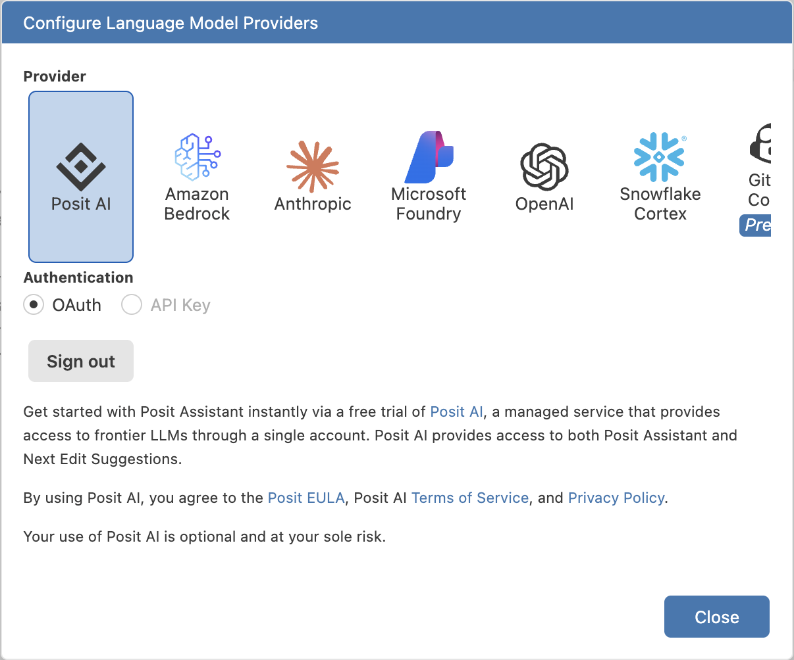{width=640 fig-alt="Official Configure Language Model Providers screenshot with multiple provider choices. Posit AI is selected; the GitHub Copilot tile is partially visible at the far right."}
:::
::: {.column width="43%"}

- The row offers several providers.
- Select **GitHub Copilot** for today's example. Scroll the row if needed.
- Complete the browser sign-in for your GitHub account.

This screenshot has **Posit AI selected**, so its sign-out button is not your
Copilot setup state.

:::
::::

::: {.source-credit}
[Posit tutorial screenshot](https://positron.posit.co/tutorial-ai-notebooks.html).
Provider names and layout can change between versions.
:::


## A request, a mode, and a permission are different

| Question | What it controls |
|---|---|
| **What did you request?** | The intended outcome and scope |
| **Which workflow or mode is active?** | Whether the assistant should explain, plan, or implement |
| **Which tools are available?** | Whether it can read, edit, execute, or inspect |
| **What is permitted?** | Which actions can proceed and which require approval |

“Explain this script” and “Edit and run this script” authorize different work.

Mode names vary. Check their behavior in the application you are using.

::: {.source-credit}
[VS Code workflows](https://code.visualstudio.com/docs/agents/overview) ·
[Example tool-approval controls](https://cursor.com/docs/agent/security/run-modes)
:::


## Assistant modes: discuss, plan, or act

In **Posit Assistant**, choose the kind of work before sending the request.

| Workflow | Purpose | What it may do |
|---|---|---|
| **Ask** (`/ask`) | Explain or inspect | Read/search files and inspect session output; cannot edit or run R/Python |
| **Plan** (`/plan`) | Develop an approach for review | Read context and write a plan; instructed to defer implementation |
| **Regular agent work** | Implement a requested change | Edit and execute, subject to permissions |

Use `/normal` to leave Ask mode. After reviewing a plan, **Exit and implement**
starts the work. A small, clear change can go directly to regular agent work.


## Agent approvals: when will it ask you?

**Ask / Plan describes the workflow. Approval settings control tool actions.**

| Approval setting | What happens |
|---|---|
| **Normal** | Routine actions may run; riskier actions prompt |
| **Restricted** | Each tool action requires confirmation |
| **Auto** | An automated reviewer allows or blocks actions |
| **YOLO** | Broad automatic approval, with some safeguards remaining |

For our demonstration, use **Normal** and inspect each proposed change.
**Allow once** approves one action; session/project approval covers future actions too.


## 3. Work through the SBP example {.section-divider}

**Start with predictions, then make increasingly broad requests.**

- Completion and next-edit suggestions: inspect the application's predictions.
- Level 1: revise existing code.
- Level 2: write specified code.
- Level 3: implement an analysis plan.
- Level 4: develop an analysis plan from a question.

At every step: provide context, inspect the response or edits, run when appropriate, and check the result.


## Familiar data: SBP at three visits

Copy `sbp-demo.R` and `sbp-demo.csv` to `work/session09/`.

| Column | Meaning |
|---|---|
| `id` | Patient identifier, one row per patient |
| `arm` | Placebo or Treatment |
| `sbp_0` | Baseline systolic blood pressure, mmHg |
| `sbp_6`, `sbp_12` | SBP at 6 and 12 weeks, mmHg |

These are the **same 60 synthetic patients from Session 4**, using only the columns needed here. Three week-12 values are missing.


## Inline completion: AI predicts code as you type

::: {style="text-align: center;"}
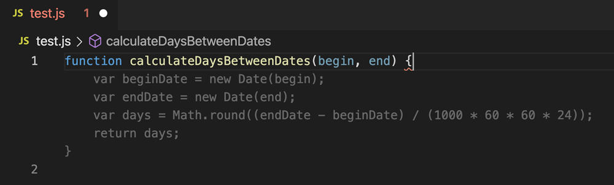{width=1100 fig-alt="Official VS Code screenshot of GitHub Copilot: a typed JavaScript function signature followed by dimmed suggested lines at the cursor."}
:::

- **Gray text** is a proposal based on the nearby code and comments.
- **Tab** accepts it. **Esc** dismisses it.
- Accepting inserts source text. Run the code yourself and check its result.

::: {.source-credit}
[Microsoft screenshot](https://code.visualstudio.com/docs/editing/ai-powered-suggestions).
JavaScript in VS Code illustrates ghost text. Our next example uses R in Positron.
:::


## Inline example: you start typing write.csv

Suppose your script has a data frame named `trial` and nearby output paths.

**You type:**

```r
write.csv(
```

**A possible completion:**

```r
write.csv(trial, "work/session09/trial-export.csv", row.names = FALSE)
```

AI predicts the object, path, and arguments from context. The application constructed a model request; you did not send an explicit task request.

Check every proposed argument. **Accepting inserts code. Executing writes the file.**


## Next-edit suggestions: a predicted change {.ai-intro}

::: {style="text-align: center;"}
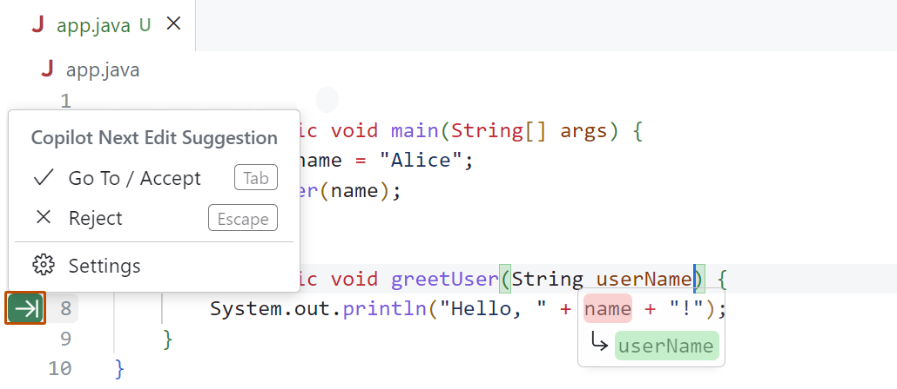{width=1000 fig-alt="Official GitHub screenshot in VS Code showing a predicted Java edit from name to userName and options to accept or reject it."}
:::

The application highlights a related edit for review. Decide whether it matches your intended change.

::: {.source-credit}
[GitHub screenshot](https://docs.github.com/en/copilot/how-tos/get-code-suggestions/get-ide-code-suggestions).
Java in VS Code illustrates the control, not the SBP exercise.
:::


## Four levels of explicit requests: the SBP example

| Level | What you provide | What AI supplies |
|---|---|---|
| **1. Revise existing code** | Plot code and a specific issue | A fix or small change |
| **2. Write specified code** | Variables, plot type, labels | Code for that defined task |
| **3. Implement an analysis plan** | An agreed plan and the dataset | Data inspection, working code, checked outputs |
| **4. Develop an analysis plan** | A research question and the dataset | A justified approach for review, then implementation |

**Level 3 starts with a plan. Level 4 starts with a question.**

Inline prediction sits outside this ladder of explicit requests.


## Level 1: revise existing code

The starter reads the CSV into `trial` and creates this plot object:

```r
p <- ggplot(trial, aes(sbp_0, sbp_12)) +
  geom_point()
```

**Debugging request:** “I sourced this script, but the plot did not appear. Explain why and show the smallest fix.”

**Editing request:** “Color these points by treatment arm. Keep the axes.”

You provide the code and a specific change or problem.


## Chat: where to ask and attach context {.ai-intro}

:::: {.columns}
::: {.column width="50%"}
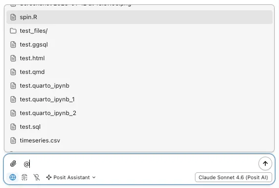{width=570 fig-alt="Official Posit Assistant screenshot: typing @ in the chat input opens a menu of workspace files, including an R script."}
:::
::: {.column width="50%"}

1. Open **Posit Assistant**.
2. Enter **`/ask`** for a read-only discussion.
3. Type **`@`** and select `work/session09/sbp-demo.R`, or paste the small code example.
4. Ask a focused question and read the explanation.

The screenshot's file names and selected model are documentation examples.

:::
::::

::: {.source-credit}
[Context screenshot](https://assistant.posit.co/docs/features/chat-features/) and
[Ask mode](https://assistant.posit.co/docs/features/ask-mode/), Posit.
:::


## Level 1: discussion and directed editing

**For an explanation:** attach the code in Ask mode and ask why sourcing it shows no plot. Read the proposed fix and apply it yourself.

**For an edit:** request “Add arm colors and print the plot. Keep the variables unchanged.” In a workflow with editing tools, inspect the resulting code differences.

Both are **level-1 requests**. The difference is whether you want an answer or a change applied to the file.


## Level 1: inspect the proposed change

```r
p <- ggplot(trial, aes(sbp_0, sbp_12, color = arm)) +
  geom_point()
print(p)
```

- `print(p)` displays the plot object when the script runs.
- `color = arm` inside `aes()` maps treatment arm to colors.
- Each point represents one patient's baseline and week-12 SBP.
- Three patients lack week-12 SBP. Account for their omitted points.

**Check the explanation, the code change, and the result.**


## Level 2: write code for a specified task

> Using `trial`, make a scatterplot with baseline SBP on x and week-12 SBP on y. Color points by arm. Label both axes in mmHg and display the plot.

**You have chosen** the variables, plot type, grouping, and labels.

**AI supplies** the implementation. Chat can return code for you to run. An agent can write and run the script if asked.

Check that x is baseline, y is week 12, and each point represents one patient.


## From a specified plot to an analysis plan

**Level 2 supplies one task:** draw the baseline-versus-week-12 scatterplot.

**Level 3 supplies a connected plan:**

1. Inspect patient IDs, variable types, visit columns, and missing values.
2. Summarize observed SBP by visit and arm, reporting the count with each mean.
3. Make the baseline-versus-week-12 scatterplot, colored by arm.
4. Save the summary and plot, then verify counts and labels.

AI works out **how to implement this plan in these data**.


## Level 3: implement the supplied analysis plan

> Implement the plan on the previous slide using `work/session09/sbp-demo.csv`. Inspect the data first. Use available SBP values for each visit-and-arm mean and report its count. Use complete baseline/week-12 pairs for the scatterplot.

> Save an R script, summary CSV, and plot PNG under `work/session09/`. Run the script and check the outputs. Keep the source CSV unchanged. Raise any issue that would require changing the plan.

You supply the analytical approach. AI handles the connected implementation and reports evidence.


## Agent screenshot: review the plan {.ai-intro}

:::: {.columns}
::: {.column width="54%"}
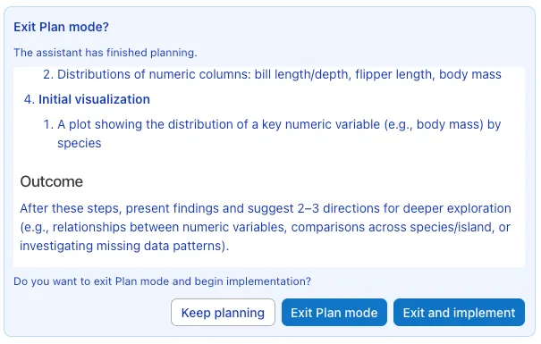{width=630 fig-alt="Official Posit Assistant screenshot showing a penguin-analysis plan and buttons to Keep planning, Exit Plan mode, or Exit and implement."}
:::
::: {.column width="46%"}

- Read the proposed steps and expected output.
- **Keep planning** lets you revise the approach.
- **Exit and implement** starts work on the plan.

For our plot task, the plan should name the **input CSV**, visit summaries,
missing-value handling, and output files.

:::
::::

::: {.source-credit}
[Posit Plan mode screenshot](https://assistant.posit.co/docs/features/plan-mode/).
The pictured plan uses penguin data. Our exercise uses the Session 4 SBP data.
:::


## Agent screenshot: inspect a proposed edit {.ai-intro}

:::: {.columns}
::: {.column width="52%"}
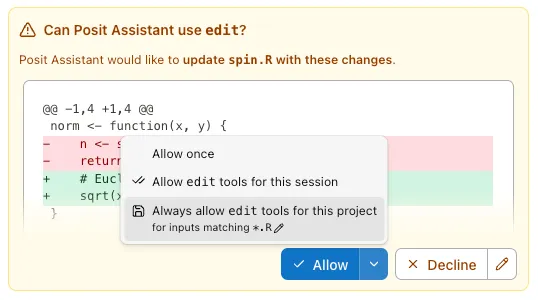{width=620 fig-alt="Official Posit Assistant edit-confirmation screenshot showing a red and green diff in spin.R and options to allow once, allow session edits, or allow project edits."}
:::
::: {.column width="48%"}

- Check the **file name** and the red/green changes.
- **Allow once** approves the displayed action.
- Broader options allow more future edits without asking again.
- Decline an unrelated change and explain what to revise.

Prompts depend on the tool's permission settings. Review the final diff too.

:::
::::

::: {.source-credit}
[Posit tool-confirmation screenshot](https://assistant.posit.co/docs/features/permissions/).
The pictured `spin.R` edit is a documentation example.
:::


## Level 3: verify the delivered outputs

| Output | What to check |
|---|---|
| **R script** | Runs from a fresh session with the intended input |
| **Visit summary CSV** | 6 rows: 3 visits × 2 arms, with observed counts |
| **Scatterplot PNG** | Baseline x, week 12 y, mmHg, arm legend |
| **Execution evidence** | 60 patients, 57 complete pairs, 3 omitted |

```r
with(trial, table(arm, is.na(sbp_12)))
#            FALSE TRUE
# Placebo       28    2
# Treatment     29    1
```


## The SBP plot we can check {.ai-intro}

::: {style="text-align: center;"}
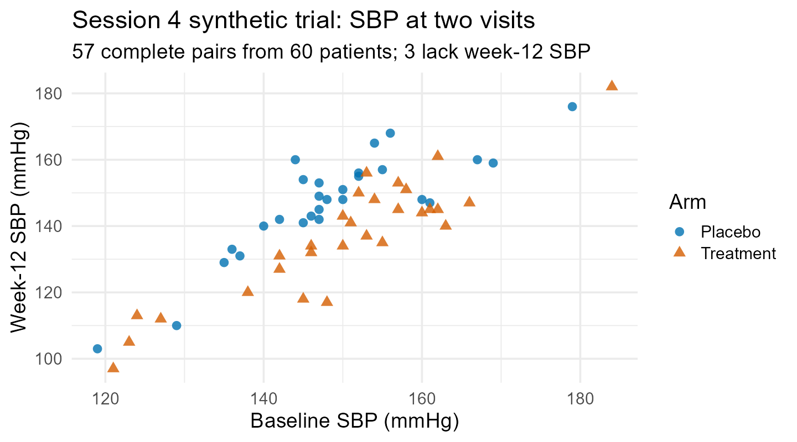{height=490 fig-alt="Scatterplot of baseline versus week-12 SBP for 57 of the 60 synthetic patients from Session 4, with treatment arm shown by color and shape."}
:::

::: {.small}
Prepared R reference output. Check the axes, arm legend, and 57 complete pairs. The three patients missing week 12 still contribute to earlier visit summaries.
:::


## Level 4: develop a plan from a question

**Research question:** “How does SBP change over the three visits, and how does that pattern differ by treatment arm?”

> Inspect the dataset and propose an analysis plan for this question. Explain the summaries and plots you would use, how you would account for repeated measurements and missing values, and what the results could tell us. Present the plan before implementing it.

Here, AI helps choose **what analysis to do and why**.

After review, carrying out that plan becomes the level-3 workflow.


## Level 3 versus level 4: what is already decided?

| | **3. Implement an analysis plan** | **4. Develop an analysis plan** |
|---|---|---|
| Starting point | Agreed steps plus data | Research question plus data |
| AI decides | How to implement the steps correctly | Which approach addresses the question and why |
| Data exploration | Checks structure and informs coding | Informs the proposed analytical approach |
| Your review | Code, outputs, and fidelity to the plan | Reasoning and assumptions, then implementation |

**A mode named “Plan” can help at either level.** These levels describe the request, not a product setting.


## Level 4: review the proposed reasoning

A useful SBP plan should explain:

1. Whether it describes visit means, within-patient change, or both.
2. Why the chosen plots answer the question about change and arm differences.
3. How it preserves patient pairing across visits and handles missing SBP.
4. Whether descriptive summaries suffice or an inferential method is needed.

**Visit means can involve different patients. A difference in visit means need not equal the mean paired change.**

An agent can implement a reviewed plan. Successful execution does not validate its scientific reasoning.


## Checkpoint: prediction, request, or plan?

1. You type `write.csv(` and AI suggests the remaining arguments.
2. “Why does sourcing my plot script show no figure?”
3. “Write a baseline-versus-week-12 scatterplot, colored by arm.”
4. “Implement these visit summaries and plot steps, then check the outputs.”
5. “How does SBP change by arm? Propose an analysis plan.”

Which is inline prediction? Which requests are levels 1–4?

**Discuss:** could chat help develop the plan even if it cannot execute R?


## 4. Verify the work and its statistical meaning {.section-divider}

**Keep the same SBP data and inspect a plausible mistake.**

The request: report the number of patients, observed week-12 SBP values, mean SBP, and SD by arm.

The trap: filtering missing SBP before counting changes the denominator.

We will predict the error, repair the code, check independently, and document the assistance.


## Evaluating an AI coding workflow

| Ask | Look for |
|---|---|
| **What did it know?** | The code, data, instructions, and context supplied |
| **What did it do?** | Suggested text, applied edits, or executed commands |
| **What evidence supports the result?** | Code differences, execution output, figures, and checks |
| **Does it answer our question?** | Correct quantities, pairing, missing-data handling, and interpretation |

**A successful run supports a claim about execution. Statistical validity requires additional reasoning.**

Apply these questions to the week-12 SBP summary on the next slides.


## Vague instructions invite hidden choices {.smaller}

**Vague:**

```r
# Summarize SBP by arm.
```

**Specific:**

```r
# Using trial, report total n, observed n, mean and SD
# of week-12 SBP by arm. Keep missing values when
# counting total n; omit them for the mean and SD.
```

These instructions can guide a completion or an explicit request. They specify the quantity you will verify.


## Plausible code can answer the wrong question

```r
trial |>
  dplyr::filter(!is.na(sbp_12)) |>
  dplyr::summarise(
    n = dplyr::n(),
    mean_sbp = mean(sbp_12),
    sd_sbp = sd(sbp_12),
    .by = arm
  )
```

What does `n` count after the filter? Does the output contain everything requested?


## Predict before running

For the proposed pipeline, write down:

1. Which rows survive the filter?
2. What will `n()` count?
3. Can an arm with more missing outcomes appear to have a smaller sample?
4. Which requested quantity is absent?


## Repair the statistical meaning

```r
trial |>
  dplyr::summarise(
    n_total = dplyr::n(),
    n_observed = sum(!is.na(sbp_12)),
    mean_sbp = mean(sbp_12, na.rm = TRUE),
    sd_sbp = sd(sbp_12, na.rm = TRUE),
    .by = arm
  )
```

Both arms have **30 patients**. Observed week-12 SBP counts are **28 Placebo** and **29 Treatment**.


## Four kinds of verification {.smaller}

| Check | Question | Example evidence |
|---|---|---|
| Execution | Did the saved code run? | exit status, output, and reviewed warnings |
| Data | Did it use the intended rows? | counts and key checks |
| Statistical | Did it estimate the intended quantity? | denominator and missingness review |
| Reproducibility | Does it work from source? | restart and render/run all |

Passing one check does not establish that the others pass.


## Five verification questions

1. What does one input row represent?
2. Which rows and columns did the code use?
3. How did it handle missing values?
4. What does one output row and denominator represent?
5. Can I verify one result independently?


## Independent checks should be small

```r
table(trial$arm)
# Placebo Treatment
#      30        30
with(trial, tapply(!is.na(sbp_12), arm, sum))
# Placebo Treatment
#      28        29
```

Compare these counts with the candidate's output. Use a check whose logic you can explain independently.


## Other common failures

- joining without checking duplicate keys;
- silently removing missing observations;
- using an unexpected denominator;
- inventing a function or argument;
- changing a working style more broadly than requested;
- producing a plot whose labels do not match its calculation.


## Good first uses are small and checkable

- complete a familiar function call;
- draft repetitive column names or plotting labels;
- translate one already-understood base-R operation to dplyr;
- propose a test case for an existing function;
- explain an error message using synthetic context.

Avoid beginning with a full analysis whose answer you cannot independently describe.


## Context creates a privacy boundary

AI completion can use surrounding code and open-file context. Never expose:

- protected health information or identifiable records;
- restricted or confidential research data;
- passwords, tokens, private keys, or `.Renviron`;
- unpublished confidential material not approved for the service.

Use only synthetic course data in this session.


## A quick privacy classification

Would you place each item in an AI-visible editor?

1. Synthetic patient IDs created for this course
2. A real medical-record number
3. A public package example
4. An unpublished collaborator dataset
5. A token copied from `.Renviron`


## Course policy after today

- AI coding assistance is allowed for homework and labs unless designated unaided.
- Copilot is our example; the same rules apply to other AI tools.
- Students remain responsible for every submitted line.
- Important results and data decisions must be verified.
- Substantive assistance must be disclosed.
- AI assistance is not permitted on any examination.


## Keep disclosure short and useful

```text
AI use: I used Posit Assistant with GitHub Copilot as provider to revise the
summary. I reviewed its missing-value handling and checked counts with base R.
```

Or:

```text
AI use: None.
```


## One workflow to carry into your own projects

1. **Specify:** state the goal, relevant context, and intended scope.
2. **Choose:** prediction, discussion, directed editing, or agent execution.
3. **Inspect:** read the response, proposed plan, and code differences.
4. **Execute:** run the saved code in the intended environment.
5. **Verify:** check data use, statistical meaning, and reproducibility.
6. **Record:** preserve the reviewed source and disclose substantive assistance.

The amount of work delegated can change. Your responsibility for the result remains.


## Exit check

1. What does the application do that the LLM does not do by itself?
2. How does inline completion differ from an explicit editing request?
3. What distinguishes implementing a plan from developing one?
4. Why did the first SBP summary report 28 and 29 instead of 30 and 30?
5. What evidence and disclosure would you keep?


## Beyond one prompt: extensions (reference)

| Concept | What it adds |
|---|---|
| **Project instructions** | Persistent guidance about the project and its conventions |
| **Skills** | Reusable instructions and resources for a particular kind of task |
| **MCP connections** | A standard way to connect supported applications to external tools or data |
| **Subagents** | Separate agent workers handling subtasks and returning results |

These extend an assistant's workflow. They do not establish that its output is correct.

::: {.source-credit}
[Context, rules, and skills](https://prod.cursor.com/docs/agent/prompting) ·
[Agent extensions](https://www.antigravity.google/docs/overview?tab=ide)
:::


## Official references {.smaller}

- [Positron: get started with AI](https://positron.posit.co/assistant-getting-started)
- [Positron: configure AI features](https://positron.posit.co/ai-configuration.html)
- [Positron: R guide](https://positron.posit.co/guide-r.html)
- [GitHub: responsible use of inline suggestions](https://docs.github.com/en/copilot/responsible-use/inline-suggestions)


## Setup troubleshooting (reference) {.smaller}

1. Confirm you are signed into the intended GitHub account.
2. Re-run the language-model provider configuration command.
3. Reload the Positron window.
4. Continue with the supplied candidate code if authentication remains blocked.

The learning goal is **specifying and verifying AI-assisted work**. Use the supplied examples if setup takes too long.

