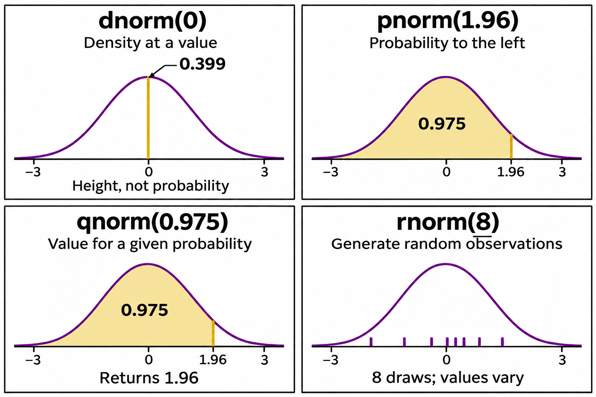

```{r}
#| label: setup
#| include: false
library(dplyr)
library(ggplot2)
library(knitr)

# Synthetic teaching data for BIOS 6301. Not real patients.
set.seed(6301)
n <- 60
trial <- data.frame(
  id        = sprintf("P%03d", 1:n),
  arm       = rep(c("Placebo", "Treatment"), each = n / 2),
  site      = sample(1:4, n, replace = TRUE),
  age       = round(rnorm(n = n, 61, 9)),
  sex       = sample(c("F", "M"), n, replace = TRUE),
  weight_kg = round(rnorm(n = n, 82, 15), 1),
  sbp_0     = round(rnorm(n = n, 148, 14)),
  stringsAsFactors = FALSE
)
trial$sbp_12 <- round(trial$sbp_0 -
  ifelse(trial$arm == "Treatment", rnorm(n = n, 14, 8), rnorm(n = n, 3, 8)))

theme_set(theme_minimal(base_size = 15))
```

## The statistical computing sequence {.smaller}

| Session | Question | Main product |
|---|---|---|
| 14 · Simulation | How does a method behave when the truth is known? | A checked simulation study |
| 15 · Resampling | What can repeated use of observed data tell us? | Uncertainty, null tests, and resampling design |
| 16 · Models and synthesis | How do the course tools support a complete analysis? | Interpretable models and a reproducible handoff |

Functions, validation, and iteration from Sessions 11–13 support all three.

## What you will be able to do {.smaller}

::: {.smaller}
[1]{.objective-num} **Explain** what a seed is, and why reproducible randomness
is not a contradiction.

[2]{.objective-num} **Draw** from a distribution using the `r*` functions, and
use `d*`, `p*`, `q*` for the other three questions.

[3]{.objective-num} **Structure** a simulation study with the ADEMP scaffold.

[4]{.objective-num} **Write** one function that simulates a dataset and one that
analyses it, and iterate over replicates.

[5]{.objective-num} **Evaluate** bias, RMSE, coverage, interval width, and failed
replicates, with **Monte Carlo uncertainty**.

[6]{.objective-num} **Explain** why more replicates reduce simulation noise,
and interpret a Monte Carlo SE for a simulated percentage.

[7]{.objective-num} **Estimate** type I error and power, and say what to do when
the type I error is not what it should be.
:::


## Session outline {.smaller}

| Block | Content |
|---|---|
| 1 | Pseudorandom numbers and reproducible streams |
| 2 | Sampling and distribution functions |
| 3 | ADEMP and known simulation truths |
| 4 | Generate, analyse, repeat, and retain failures |
| 5 | Bias, coverage, precision, and Monte Carlo error |
| 6 | Type I error, power, and allocation |
| 7 | Scenario sensitivity and lab decisions |

Use base R or tidyverse consistently; validate the same statistical target.

# 1 · Pseudorandom numbers {.section-divider}

## How R makes random numbers {.smaller}

A fixed algorithm gives the same output from the same starting state.
R's usual **pseudorandom generator** uses such an algorithm to produce numbers
that behave like random draws.

Computers can also obtain randomness from physical sources, such as electronic
noise. Statistical simulation usually uses pseudorandom numbers for speed and
reproducibility.

```{r}
#| label: rng-introduction
set.seed(42)
rnorm(n = 3, mean = 120, sd = 10)  # simulate 3 blood pressures
```

- A **seed** chooses a starting state. Each random call advances the generator.
- The same seed and calls reproduce the results in the same R/RNG environment.
- Reproducibility lets us share simulated data and debug the same example.


## The seed picks your starting point {.smaller}

```{r}
#| label: seed-demo
set.seed(42)
rnorm(n = 3)

set.seed(42)
rnorm(n = 3)
```

## New calls advance the random stream {.smaller}

```{r}
#| label: seed-demo-2
set.seed(42)
rnorm(n = 3)
rnorm(n = 3)
```

. . .

::: {.callout-note appearance="simple"}
**Reproducible randomness is not a contradiction.** The same seed, RNG settings, and sequence of random calls reproduce a run in the same computational environment. Changing the calls changes the stream used downstream.
:::


## `.Random.seed` remembers where R is {.smaller}

R stores its current generator state in **`.Random.seed`**, an integer vector.
Think of it as a bookmark: `set.seed(42)` resets it, and random calls update it.

:::: {.columns}
::: {.column width="50%"}
**Original code**

```{r}
#| label: random-seed-original
set.seed(42)
round(rnorm(n = 3), 3)
round(rnorm(n = 3), 3)
```

Rerun this block: both outputs repeat.
:::
::: {.column width="50%"}
**An unrelated random call inserted**

```{r}
#| label: random-seed-inserted
set.seed(42)
round(rnorm(n = 3), 3)
unused <- runif(1)  # moves the bookmark
round(rnorm(n = 3), 3)
```

The first output matches. The second changes.
:::
::::

Even unused random draws change later results. Calculations such as `2 + 2` do not.


## A seed before each result you want to reproduce {.smaller}

Place `set.seed()` immediately before each simulation or analysis block whose
output should stay the same when earlier code changes.

:::: {.columns}
::: {.column width="50%"}
**The result we want to reproduce**

```{r}
#| label: seed-result-original
set.seed(99)
round(rnorm(n = 3), 3)
```
:::
::: {.column width="50%"}
**Earlier random work can change**

```{r}
#| label: seed-result-protected
unused <- runif(100)
set.seed(99)  # reset just before this result
round(rnorm(n = 3), 3)
```
:::
::::

Both blocks give the same result because `set.seed(99)` resets `.Random.seed`
immediately before `rnorm(n = 3)`.

**For a simulation loop:** set the seed once **before the loop**. Resetting the
same seed inside every replicate repeats the same draws.


# 2 · Drawing from distributions {.section-divider}

## `sample()`: permutation and bootstrap {.smaller}

```{r}
#| label: sample-demo
set.seed(13)
ids <- c("A", "B", "C", "D")
sample(ids, 4, replace = FALSE)  # every patient once: permutation
sample(ids, 4, replace = TRUE)   # patients may repeat: bootstrap
```

. . .

::: {.smaller}
- **Without replacement:** leave each selected card out of the bag. Drawing
  all four gives a permutation. Drawing only two selects a subset.
- **With replacement:** return each card before the next draw. Some patients
  may appear several times and others may be absent.
- **Resampling** includes both bootstrap and permutation methods. Their
  statistical questions and resampling rules differ.
:::


## The `sample()` trap {.smaller}

```{r}
#| label: sample-trap
set.seed(13)
sites <- c(7)          # one site left after exclusions
sample(sites)          # you wanted 7
```

. . .

::: {.smaller}
`sample(x)` with a length-1 numeric `x` samples from `1:x`. **No error, no
warning, plausible output** — the exact failure mode session 12 was about.
:::

. . .

```{r}
#| label: sample-safe
# The idiom from ?sample. Correct for every length, including 0 and 1.
resample <- function(x, ...) x[sample.int(length(x), ...)]
set.seed(13)
resample(sites)
```


## Four views of the standard normal distribution {.smaller}

{height=510 fig-alt="Four schematic panels: dnorm(0) gives density height about 0.399; pnorm(1.96) gives left-tail probability about 0.975; qnorm(0.975) returns cutoff about 1.96; rnorm(n = 8) generates eight observations."}

::: {style="font-size:20px"}
AI-generated schematic, not to scale. Values refer to a normal distribution with mean 0 and SD 1.
:::

## Distribution functions: prefix + name {.smaller}

Combine a prefix with a distribution name: `r` + `norm` gives `rnorm()`.

:::: {.columns}
::: {.column width="52%"}
**What do you want to find?**

| Prefix | Meaning | Example |
|---|---|---|
| `d` | Density or probability mass | `dnorm(0)` |
| `p` | Probability up to a value | `pnorm(1.96)` |
| `q` | Value at a given probability | `qnorm(0.975)` |
| `r` | Random draws | `rnorm(n = 10)` |

`pnorm(1.96)` is about 0.975.\
`qnorm(0.975)` is about 1.96.
:::
::: {.column width="48%"}
**Which distribution?**

| Name | Distribution |
|---|---|
| `norm` | Normal (Gaussian) |
| `unif` | Uniform |
| `binom` | Binomial |
| `pois` | Poisson |
| `t` | Student's t |
| `chisq` | Chi-squared |
| `exp` | Exponential |
| `gamma` | Gamma |
| `beta` | Beta |
:::
::::

## `rnorm`, `runif`, `rbinom` {.smaller}

```{r}
#| label: r-funs
set.seed(13)
round(rnorm(n = 3, mean = 148, sd = 14), 1)  # n, then the parameters
round(runif(3, min = 0, max = 1), 3)
rbinom(3, size = 1, prob = 0.3)          # 3 coin flips
rbinom(3, size = 10, prob = 0.3)         # 3 counts out of 10
```

## Generate observations with different parameters {.smaller}

::: {.smaller}
**Parameters recycle**, which is how you generate a whole trial in one call:
:::

```{r}
#| label: r-vectorised
set.seed(13)
round(rnorm(n = 6, mean = rep(c(148, 134), each = 3), sd = 14))
```


# 3 · ADEMP — a protocol for a simulation {.section-divider}

## A simulation is an experiment {.smaller}

We create data under known conditions, apply a statistical method, and check
how well it works across many simulated datasets.

Before running it, write down:

- What question are we asking?
- How will we generate the data and analyse each dataset?
- How will we judge the results?

**ADEMP** gives us five headings for this plan.

::: {style="font-size:24px; margin-top:1.5em"}
Optional background: Morris, White & Crowther (2019),
["Using simulation studies to evaluate statistical methods"](https://doi.org/10.1002/sim.8086),
*Statistics in Medicine*, 38:2074–2102.
:::

## ADEMP {.smaller}

::: {style="font-size:0.86em"}
| | | You must be able to write down |
|---|---|---|
| **A** | Aims | The question, in one sentence |
| **D** | Data-generating mechanism | Exactly how **one** dataset is produced. Every parameter, every value |
| **E** | Estimands | The quantity being estimated — a number that exists before any method touches it |
| **M** | Methods | The procedures being compared, including the naive one |
| **P** | Performance measures | How you decide which method won, **and with what precision** |
:::

. . .

::: {.smaller}
Five headings, and the discipline is that you fill them in **before** you write
any code.
:::


## ADEMP for an SBP trial {.smaller}

Our simulated trial measures **SBP reduction = baseline minus 12-week SBP** (mmHg).
A larger reduction means a larger drop.

::: {style="font-size:0.82em"}
- **A · Aim:** How reliably can we estimate the treatment's additional mean SBP
  reduction when group sizes and variability differ?
- **D · Data:** Generate independent normal SBP reductions. Control: mean 0,
  SD 12. Treatment: mean $\delta$, SD 4. Group sizes: 25/25, 10/40, or 40/10.
- **E · Estimand:** $\delta =$ treatment minus control mean reduction.
  A value of 6 means an additional 6 mmHg drop with treatment.
- **M · Methods:** Difference in sample means, with Welch or pooled *t*
  procedures for the confidence interval and p-value.
- **P · Performance:** Bias, 95% interval coverage, and detection of an effect.
  When $\delta = 0$, check false positives.
:::


## Estimand: the quantity we want to learn {.smaller}

For the **same SBP trial**, suppose mean reduction is 0 mmHg under control and
6 mmHg under treatment. How much additional reduction does treatment provide?

| Term | Meaning | Example in our simulation |
|---|---|---|
| **Estimand** | The true additional mean SBP reduction | $\delta = 6 - 0 = 6$ mmHg |
| **Estimator** | The rule applied to sampled patients | Mean reduction in treatment minus mean reduction in control |
| **Estimate** | The result from one simulated trial | For example, 7.2 mmHg additional reduction |

We set the population means, so we **know the truth is 6**. New samples give
different estimates, but the target stays 6.

If the estimates average 6.3 over many replicates, estimated **bias** is
$6.3 - 6 = 0.3$ mmHg. One estimate's error, $7.2 - 6$, is not the bias.


# 4 · Building the simulation {.section-divider}

## Data generation starts with assumptions {.smaller}

A **data-generating model** describes the population and how we sample from it.
We choose this model before choosing an R random-number function.

- **Outcome:** each patient's SBP reduction, baseline minus 12-week SBP.
  Values can be positive or negative. A negative value means SBP increased.
- **Distribution:** what shape, spread, and extreme values are plausible
  within each treatment group?
- **Structure:** are patients independent? Repeated visits or patients within
  clinics may require a model for their dependence.
- **Parameters:** use previous studies, pilot data, or subject-matter knowledge
  to choose plausible means and SDs. Explore a range when these are uncertain.

Our means and SDs are **invented teaching scenarios**, not clinical estimates.

## Why use a normal distribution here? {.smaller}

We start with normal SBP reductions as a **simple reference scenario**. This lets
us study unequal group sizes and SDs while keeping the distribution's shape fixed.

For a real project, examine relevant prior or pilot data: group-specific
histograms, Q–Q plots, outliers, and plausible ranges. Rough symmetry and modest
tails may support a normal approximation. They do not prove it.

A normal model allows any real value. It may be unsuitable if it generates
implausible changes, strong skewness is present, or extreme values are common.

**Sensitivity check:** repeat the study with skewed errors while preserving
the population means and SDs. Report whether the conclusions change.


## From the SBP model to rnorm() {.smaller}

For one teaching scenario, assume independent reductions within each arm:

$$
Y_{\mathrm{control}} \sim N(0,12^2), \qquad
Y_{\mathrm{treatment}} \sim N(6,4^2).
$$

The treatment group's **population mean is 6 mmHg and SD is 4 mmHg**.
In the formula the second quantity is variance. R's `sd` argument takes the SD.

```{r}
set.seed(1425)
reduction <- rnorm(n = 5, mean = 6, sd = 4)
round(reduction, 1)
```

`rnorm()` implements our assumption. These five patients need not have a sample
mean of exactly 6 or a sample SD of exactly 4.

Before a large run, inspect simulated ranges, plots, and group summaries.
That checks the generator's implementation; real-world plausibility needs evidence.

## The shape of every simulation {.smaller}

```{mermaid}
%%| echo: false
%%| fig-width: 10
flowchart LR
  P["<b>data model</b><br/>shape, dependence, parameters"] --> S["<b>simulate_one()</b><br/>one dataset"]
  S --> A["<b>analyse_one()</b><br/>one row of results"]
  A --> R["<b>replicate</b><br/>× n_sim"]
  R --> T["<b>results</b><br/>one row per replicate"]
  T --> M["<b>performance</b><br/>bias, SE, rejection rate"]
  style S fill:#CFAE70,stroke:#8a7448,color:#fff
  style A fill:#CFAE70,stroke:#8a7448,color:#fff
  style P fill:#f4efe4,stroke:#CFAE70
```

. . .

::: {.smaller}
Session 11 gave you **functions**. Session 13 gave you **iteration**. This is what
they were for.
:::


## Generate one dataset {.smaller}

```{r}
#| label: sim-one
# y is SBP reduction; independent normal outcomes within each arm.
simulate_trial <- function(n_ctrl, n_trt, sd_ctrl, sd_trt, delta = 0) {
  stopifnot(n_ctrl >= 2, n_trt >= 2, sd_ctrl > 0, sd_trt > 0)
  data.frame(
    arm = rep(c("ctrl", "trt"), c(n_ctrl, n_trt)),
    y   = c(rnorm(n = n_ctrl, mean = 0, sd = sd_ctrl),
            rnorm(n = n_trt, mean = delta, sd = sd_trt))
  )
}

set.seed(6301)
d_example <- simulate_trial(n_ctrl = 3, n_trt = 3,
                            sd_ctrl = 12, sd_trt = 4, delta = 8)
head(d_example, n = 3)
```


## Analyse one dataset {.smaller}

```{r}
analyse_trial <- function(data, pooled = FALSE) {
  x <- data$y[data$arm == "trt"]
  y <- data$y[data$arm == "ctrl"]
  fit <- t.test(x = x, y = y, var.equal = pooled)
  c(est = mean(x) - mean(y), se = fit$stderr,
    p = fit$p.value, lo = fit$conf.int[1], hi = fit$conf.int[2])
}
set.seed(6301)
d_analysis <- simulate_trial(n_ctrl = 20, n_trt = 20,
                             sd_ctrl = 12, sd_trt = 4, delta = 8)
round(analyse_trial(data = d_analysis, pooled = FALSE), digits = 3)
```

Passing treatment first makes the estimate and interval both treatment minus control.
Check this direction before running any replications.

## Compare methods on the same dataset {.smaller}

```{r}
set.seed(1401)
one_data <- simulate_trial(n_ctrl = 10, n_trt = 40,
                           sd_ctrl = 12, sd_trt = 4, delta = 0)
one_pair <- rbind(Welch = analyse_trial(data = one_data, pooled = FALSE),
                 pooled = analyse_trial(data = one_data, pooled = TRUE))
round(one_pair, 3)
stopifnot(one_pair["Welch", "est"] == one_pair["pooled", "est"])
```

Both tests estimate the same mean difference. Their standard errors, degrees of
freedom, intervals, and p-values can differ. Pairing methods within a replicate
also supports direct comparisons of their performance.

## `replicate()`: repeat an expression {.smaller}

`replicate(n, expr)` evaluates `expr` again for each repetition and collects
the outputs. Put the random-data generation **inside** the expression.

```{r}
#| label: replicate-introduction
set.seed(1431)
draws <- replicate(n = 3, expr = rnorm(n = 4, mean = 0, sd = 1))
round(draws, digits = 2)
```

- `replicate(n = 3, ...)` means **three repetitions**.
- `rnorm(n = 4, ...)` means **four observations per repetition**.
- Each column contains one repetition's four values. Equal-length vector
  outputs form a matrix by default. A scalar output gives a vector.


## A function for one simulation scenario {.smaller}

```{r}
#| label: replicate-demo
run_scenario <- function(n_sim, n_ctrl, n_trt, sd_ctrl, sd_trt,
                         delta = 0, pooled = TRUE) {
  out <- replicate(n = n_sim, expr = {
    d <- simulate_trial(n_ctrl = n_ctrl, n_trt = n_trt,
                        sd_ctrl = sd_ctrl, sd_trt = sd_trt, delta = delta)
    analyse_trial(data = d, pooled = pooled)
  })
  as.data.frame(t(out))          # n_sim rows, one per replicate
}
```

Each repetition generates a new trial and returns five analysis results.
`t(out)` transposes the matrix so **each row becomes one simulated trial**.

## A five-trial pilot {.smaller}

```{r}
#| label: replicate-pilot
set.seed(6301)
demo <- run_scenario(n_sim = 5, n_ctrl = 20, n_trt = 20,
                     sd_ctrl = 12, sd_trt = 4, delta = 8, pooled = FALSE)
round(demo, digits = 3)
```

Five trials, **20 patients per arm in each trial**. Read one row as an estimate,
its SE, a p-value, and confidence limits. New trials give different rows.

Check this small output before increasing `n_sim` to hundreds or thousands.


## Store results tidily {.smaller}

Keep **one row per replicate**, and carry every parameter that varies:

```{r}
#| label: tidy-results
set.seed(6301)
res <- run_scenario(n_sim = 200, n_ctrl = 10, n_trt = 40,
                    sd_ctrl = 12, sd_trt = 4, delta = 0, pooled = TRUE)
res$n_ctrl <- 10; res$n_trt <- 40; res$method <- "pooled"

res |>
  group_by(method) |>
  summarise(reject = mean(p < 0.05), bias = mean(est), emp_se = sd(est))
```

::: {.smaller}
::: {.callout-tip appearance="simple"}
**The base R way**
```r
c(reject = mean(res$p < 0.05), bias = mean(res$est), emp_se = sd(res$est))
```
:::
:::


## A grid of simulation scenarios {.smaller}

Each row specifies one setting. We use **Welch throughout this grid**, with
SDs 12 and 4 and 50 patients per trial. Allocation and true effect vary.

```{r}
#| label: grid
grid <- expand.grid(n_ctrl = c(25, 10, 40), delta = c(0, 6))
grid$n_trt <- 50 - grid$n_ctrl
grid$scenario <- seq_len(nrow(grid))
grid$seed <- 6300 + grid$scenario
grid
```

. . .

::: {.smaller}
Three allocations × two effects = **six scenarios**.
At 200 trials per scenario, we will generate and analyse **1,200 trials**.
:::

## One grid row supplies the function arguments {.smaller}

```{r}
#| label: grid-one-row
s <- grid[2, ]
s
set.seed(s$seed)
one_scenario <- run_scenario(
  n_sim = 5, n_ctrl = s$n_ctrl, n_trt = s$n_trt,
  sd_ctrl = 12, sd_trt = 4, delta = s$delta, pooled = FALSE)
head(one_scenario, n = 2)
```

Here `s$n_ctrl`, `s$n_trt`, and `s$delta` come from **row 2**: 10 control patients,
40 treatment patients, and a true effect of 0. The function applies this setting
to every trial in the pilot.

## Run every row of the grid {.smaller}

```{r}
#| label: grid-run
results_by_scenario <- vector(mode = "list", length = nrow(grid))
for (i in seq_len(nrow(grid))) {
  s <- grid[i, ]
  set.seed(s$seed)
  r <- run_scenario(
    n_sim = 200, n_ctrl = s$n_ctrl, n_trt = s$n_trt,
    sd_ctrl = 12, sd_trt = 4, delta = s$delta, pooled = FALSE)
  results_by_scenario[[i]] <- cbind(
    s, replicate = seq_len(nrow(r)), method = "Welch", r)
}
grid_results <- do.call(what = rbind, args = results_by_scenario)
```

The outer `for` loop changes the **scenario**. Inside `run_scenario()`,
`replicate()` repeats **trials within that scenario**. `cbind()` attaches the
design row to every trial; `rbind()` combines all scenarios' rows.

## Check and summarize the combined results {.smaller}

```{r}
#| label: grid-checks
#| include: false
stopifnot(nrow(grid_results) == nrow(grid) * 200,
          all(table(grid_results$scenario) == 200))
pilot_rows <- grid_results[grid_results$scenario == 2 &
                            grid_results$replicate <= 5, names(one_scenario)]
stopifnot(identical(unname(as.matrix(pilot_rows)),
                    unname(as.matrix(one_scenario))))
```

```{r}
#| label: grid-summary
grid_summary <- grid_results |>
  group_by(scenario, n_ctrl, n_trt, delta) |>
  summarise(reject = mean(p < 0.05),
            bias = mean(est) - first(delta), .groups = "drop")
knitr::kable(grid_summary, digits = 3, align = "c")
```

Checks confirm **1,200 trials: 200 per scenario**. Rejection estimates type I error
at `delta = 0` and power at `delta = 6`. Monte Carlo uncertainty comes next.

## Save results with the design {.smaller}

```r
bundle <- list(results = grid_results, scenarios = grid,
               settings = list(n_sim = 200, sd_ctrl = 12,
                               sd_trt = 4, pooled = FALSE),
               rng = RNGkind(), session = sessionInfo())
dir.create("output", showWarnings = FALSE)
saveRDS(bundle, "output/simulation.rds")
```

- The saved results now match all six design rows, including their recorded seeds.
- Record the code version alongside the parameters and computational environment.
- Rerun when the generator, analysis, or scenario definition changes.
- A file's existence is not evidence that it matches the current specification.

For expensive studies, run a script once and let the report read the saved results.

## A buggy simulation does not crash {.smaller}

```{r}
#| label: seed-bug
simulate_bad <- function(n_ctrl, n_trt, sd_ctrl, sd_trt, delta = 0) {
  set.seed(6301)                       # <- the bug
  simulate_trial(n_ctrl = n_ctrl, n_trt = n_trt,
                  sd_ctrl = sd_ctrl, sd_trt = sd_trt, delta = delta)
}

bad <- replicate(n = 500, expr = {
  d <- simulate_bad(n_ctrl = 25, n_trt = 25,
                    sd_ctrl = 12, sd_trt = 4, delta = 0)
  analyse_trial(data = d, pooled = FALSE)
})
bad <- as.data.frame(t(bad))
c(reject = mean(bad$p < 0.05), bias = mean(bad$est), emp_se = sd(bad$est))
```

. . .

::: {.smaller}
Resetting the seed repeats **one dataset**. Empirical SE is zero, and the reported
bias is just one estimate's error.
:::


## Assertions for simulations {.smaller}

::: {style="font-size:0.86em"}
| Where | Check |
|---|---|
| **Arguments** | `stopifnot(n_ctrl >= 2, sd_ctrl > 0, length(delta) == 1)` |
| **The DGM** | Simulate once at $n = 10^6$; the empirical mean and SD should be close to the parameters within simulation variation |
| **The results object** | `nrow(res) == n_sim`, count failed/nonfinite rows; check variability where expected |
| **A known case** | A setting where you know the answer must return it, to within Monte Carlo error |
:::

## Check a known data-generating mechanism {.smaller}

```{r}
#| label: dgm-check
set.seed(6301)
check <- simulate_trial(n_ctrl = 1e6, n_trt = 1e6,
                        sd_ctrl = 12, sd_trt = 4, delta = 8)
stopifnot(
  abs(mean(check$y[check$arm == "trt"]) - 8) < 0.05,
  abs(sd(check$y[check$arm == "ctrl"]) - 12) < 0.05
)
"DGM checks passed"
```


## Keep a failed replicate visible {.smaller}

```{r}
analyse_checked <- function(data, pooled = FALSE) {
  tryCatch({
    value <- analyse_trial(data = data, pooled = pooled)
    if (any(!is.finite(value))) stop("nonfinite result")
    list(value = value, error = NA_character_)
  }, error = function(e) list(value = NULL, error = conditionMessage(e)))
}
bad_data <- data.frame(arm = rep(c("ctrl", "trt"), each = 3), y = 1)
analyse_checked(data = bad_data)$error
```

Retain the replicate ID, scenario, method, and reason. Warnings also need review;
this wrapper catches errors, not warnings.

## Failure changes the denominator {.smaller}

Suppose 100 attempts produce 90 valid intervals, of which 86 contain the truth.

| Quantity | Calculation | Interpretation |
|---|---|---|
| Failure rate | 10 / 100 | Procedure did not return an interval |
| Coverage among successful fits | 86 / 90 | Conditional on success |
| Successful coverage per attempt | 86 / 100 | Counts failure as unsuccessful coverage |

Report the failure rate and the chosen denominator. Silently applying
`na.rm = TRUE` can hide poor performance in difficult samples.

# 5 · Performance measures {.section-divider}

## What you actually report {.smaller}

::: {style="font-size:0.84em"}
| Measure | Estimated by | Answers |
|---|---|---|
| **Bias** | $\bar{\hat\theta} - \theta$ | Is the estimator systematically off? |
| **Empirical SE** | $\mathrm{sd}(\hat\theta)$ | How variable is it, run to run? |
| **Coverage** | $\frac{1}{n_{\text{sim}}}\sum \mathbb{1}\{\hat\theta_{\text{lo}} \le \theta \le \hat\theta_{\text{hi}}\}$ | Does the 95% CI cover 95% of the time? |
| **Type I error** | $\mathrm{mean}(p < \alpha)$, with $\theta = 0$ | Does the test hold its size? |
| **Power** | $\mathrm{mean}(p < \alpha)$, with $\theta \ne 0$ | Will the study detect a real effect? |
:::

. . .

::: {.smaller}
Type I error and power are the **same computation** on data from the same DGM
with `delta` set differently. Nothing else changes.
:::


## Why simulation results have uncertainty {.smaller}

**Monte Carlo** means using repeated random draws to answer a question.

Suppose a test really rejects 5% of the time under the null. In 1,000 simulated
trials, we expect about 50 rejections, but we will not always get exactly 50.

- A run might give 52 rejections: **52 / 1,000 = 5.2%**.
- A new seed gives new datasets, so the rejection count may change.
- This variation from using a finite number of replicates is **Monte Carlo uncertainty**.

A fixed seed reproduces the same answer. **More replicates** make the answer
less sensitive to the particular random draws.

## Two kinds of uncertainty {.smaller}

| | Sampling uncertainty | Monte Carlo uncertainty |
|---|---|---|
| What varies? | A treatment effect estimate across trials | A rejection rate across full simulation runs |
| Example | Each trial has 50 patients | Each simulation run contains 1,000 trials |
| What helps? | More patients per trial | More simulated trials per run |

Increasing **patients per trial** changes the study we are evaluating.
Increasing **replicates** helps us evaluate that same study more precisely.

## One calculation for a simulated percentage {.smaller}

The **Monte Carlo standard error (MCSE)** describes how much a simulated
proportion varies across repeated runs of the simulation.

For independent replicates, $\mathrm{MCSE} = \sqrt{\hat p(1-\hat p)/B}$,
where $\hat p$ is the observed proportion and $B$ is the number of replicates.

```{r}
#| label: mcse
p_hat <- 52 / 1000
n_sim <- 1000
mcse <- sqrt(p_hat * (1 - p_hat) / n_sim)
round(100 * c(rate = p_hat, MCSE = mcse,
              lower = p_hat - 1.96 * mcse,
              upper = p_hat + 1.96 * mcse), 2)
```

The rate is **5.2%**, with MCSE **0.70 percentage points** and an approximate
95% Monte Carlo interval of **3.82% to 6.58%**. This run gives little evidence
that the true rejection rate differs from 5%.


## Coverage and interval width in code {.smaller}

```{r}
set.seed(1402)
check_ci <- run_scenario(n_sim = 1000, n_ctrl = 10, n_trt = 40,
                         sd_ctrl = 12, sd_trt = 4, delta = 6, pooled = FALSE)
covered <- check_ci$lo <= 6 & 6 <= check_ci$hi
c(bias = mean(check_ci$est) - 6,
  empirical_se = sd(check_ci$est), mean_model_se = mean(check_ci$se),
  coverage = mean(covered), width = mean(check_ci$hi - check_ci$lo),
  coverage_mcse = sqrt(mean(covered) * (1 - mean(covered)) / nrow(check_ci)))
```

The truth is **6**, not the estimate from one simulated sample.
Wide intervals may cover well while being too imprecise to be useful.

## Bias, variance, and RMSE {.smaller}

```{r}
error <- check_ci$est - 6
c(bias = mean(error), rmse = sqrt(mean(error^2)),
  mcse_bias = sd(error) / sqrt(length(error)))
```

RMSE summarizes squared estimation error; coverage evaluates an interval procedure.
They answer different questions. A small bias does not imply a calibrated interval.

## Optional: no rejections does not mean zero probability {.smaller}

```{r}
binom.test(0, 1000)$conf.int
```

Zero rejections out of 1,000 does not establish a true rejection probability of zero.
The plug-in MCSE formula gives zero here; a binomial interval exposes the remaining uncertainty.

Use interval estimates near zero or one, and state the number of valid replicates.

## More replicates give a steadier answer {.smaller}

For a rejection probability near 5%:

| Replicates | Expected rejections | MCSE (percentage points) |
|---|---|---|
| 100 | 5 | 2.18 |
| 1,000 | 50 | 0.69 |
| 10,000 | 500 | 0.22 |

**Four times as many replicates halves the MCSE.** More precision costs more
computing time.

Start with a small run to check the code. Then choose a larger, fixed number
of replicates and report the MCSE with the final result.


## Optional: choosing replicates for a target precision {.smaller}

```{r}
target <- 0.005
ceiling(c(near_null = 0.05 * 0.95, worst_case = 0.25) / target^2)
```

The conservative bound uses $p(1-p) \le 0.25$ and covers every probability.
A design sized for Type I error near 0.05 can give less precise power estimates.

Choose the precision target before inspecting favorable results. Use a pilot to
debug and estimate computational cost, then run the planned study.

# 6 · Type I error and power {.section-divider}

## The question, restated {.smaller}

Two arms. **Different variances** — 12 vs 4 mmHg. **Different sizes** — and it is
the *combination* that does the damage.

::: {.smaller}
The pooled *t*-test assumes a common variance. It estimates one $s_p$ from both
arms, weighting by degrees of freedom, and gets $n_1 + n_2 - 2$ df. Welch
estimates each arm's variance separately and adjusts the df downwards.
:::

. . .

::: {.smaller}
`t.test()` defaults to `var.equal = FALSE`. The pooled and Welch procedures use different standard-error formulas; neither corrects a wrong sampling unit or a biased dataset.
:::

. . .

::: {.callout-note appearance="simple"}
Four scenarios, $\delta = 0$, $n_{\text{sim}} = 10{,}000$. If the test is behaving,
an individual rejection estimate is typically within about 0.0044 of 0.05. This is an approximate simulation uncertainty range, not a guarantee for every scenario.
:::


## Run it {.smaller}

```{r}
#| label: type1-run
n_sim <- 10000
set.seed(6301)

scenarios <- list(
  list(lab = "25 / 25", nc = 25, nt = 25, pooled = TRUE),
  list(lab = "10 / 40", nc = 10, nt = 40, pooled = TRUE),
  list(lab = "40 / 10", nc = 40, nt = 10, pooled = TRUE),
  list(lab = "10 / 40", nc = 10, nt = 40, pooled = FALSE)
)

type1 <- do.call(rbind, lapply(scenarios, function(s) {
  r <- run_scenario(n_sim = n_sim, n_ctrl = s$nc, n_trt = s$nt,
                    sd_ctrl = 12, sd_trt = 4,
                    delta = 0, pooled = s$pooled)
  data.frame(alloc = s$lab, method = ifelse(s$pooled, "pooled", "Welch"),
             reject = mean(r$p < 0.05), bias = mean(r$est), emp_se = sd(r$est))
}))
type1$mcse <- sqrt(type1$reject * (1 - type1$reject) / n_sim)
```


## The type I error is not 0.05 {.smaller}

```{r}
#| label: type1-table
#| echo: false
type1 |>
  transmute(
    Allocation = alloc, Method = method,
    `Rejection rate` = sprintf("%.4f", reject),
    `MC SE` = sprintf("%.4f", mcse),
    Bias = sprintf("%+.3f", bias),
    `Emp. SE` = sprintf("%.2f", emp_se)
  ) |>
  kable(align = "llrrrr")
```

::: {.smaller}
$\sigma_{\text{ctrl}} = 12$, $\sigma_{\text{trt}} = 4$, $\delta = 0$,
$n_{\text{sim}} = 10{,}000$. Nominal $\alpha = 0.05$.
:::

. . .

::: {.smaller}
- **10 / 40 pooled** — the small arm is the noisy one. Rejects **five times too
  often**.
- **40 / 10 pooled** — reverse the allocation and the test becomes absurdly
  conservative.
- **Bias is essentially zero in every row.** The estimate was never the problem.
:::


## Inspect the null p-value distribution {.smaller}

```{r}
#| label: fig-pvals
#| echo: false
#| fig-width: 9.5
#| fig-height: 3.4
#| fig-cap: "Null p-values, 10,000 replicates, n = 10 / 40, sd = 12 / 4."
set.seed(97)
pv <- rbind(
  data.frame(method = "Pooled t-test",
             p = run_scenario(n_sim = 10000, n_ctrl = 10, n_trt = 40,
               sd_ctrl = 12, sd_trt = 4, delta = 0, pooled = TRUE)$p),
  data.frame(method = "Welch t-test",
             p = run_scenario(n_sim = 10000, n_ctrl = 10, n_trt = 40,
               sd_ctrl = 12, sd_trt = 4, delta = 0, pooled = FALSE)$p)
)
ggplot(pv, aes(p)) +
  geom_histogram(breaks = seq(0, 1, 0.05), fill = "#CFAE70", colour = "white") +
  geom_hline(yintercept = 500, linetype = 2) +
  facet_wrap(~method) +
  labs(x = "p-value under the null", y = "count")
```

::: {.smaller}
For an exact continuous null p-value, the expected count is 500 per bin. Welch is approximate; discrete valid tests may be conservative rather than uniform. Excess near zero can reveal inflated Type I error.
:::


## Interpret the method comparison {.smaller}

Welch uses $\sqrt{s_1^2/n_1+s_2^2/n_2}$ with approximate degrees of freedom.

- In this normal unequal-variance scenario, compare its rejection rate with 0.05
  using the reported MCSE.
- The pooled test uses a common variance estimate and can be badly calibrated
  when the smaller group has the larger variance.
- This study has not yet measured the cost of Welch under equal variances.

Add an equal-variance scenario before making a claim about that tradeoff.

## Power: detecting a specified treatment effect {.smaller}

Suppose treatment truly produces **6 mmHg more mean SBP reduction** than control.
Our test still asks whether the population mean difference is zero.

**Power is the probability that the planned test rejects that null when the
specified effect is real.** Power of 80% means about 80 of 100 repeated trials
would reject it. The remaining 20 would miss the effect (type II error).

To estimate power by simulation:

1. Specify the effect, distributions, sample sizes, and analysis in advance.
2. Generate one complete trial under that nonzero effect.
3. Apply the planned test and record whether `p < 0.05`.
4. Repeat independently and calculate the proportion of rejections.

Here we use a **two-sided Welch test at 5%**. At a true effect of zero, the same
calculation estimates type I error instead of power to detect a nonzero effect.

## Estimated power for one SBP design {.smaller}

Assume independent normal reductions, **40 patients per arm**, SDs 12 and 4,
and a true additional reduction of **6 mmHg**.

```{r}
#| label: power-worked
set.seed(1456)
power_run <- run_scenario(n_sim = 2000, n_ctrl = 40, n_trt = 40,
                          sd_ctrl = 12, sd_trt = 4, delta = 6, pooled = FALSE)
stopifnot(nrow(power_run) == 2000, all(is.finite(power_run$p)))
detected <- power_run$p < 0.05
power_hat <- mean(detected)
power_mcse <- sqrt(power_hat * (1 - power_hat) / nrow(power_run))
round(c(power = power_hat, MCSE = power_mcse), 3)
```

We detected the effect in **`r sum(detected)` of 2,000 trials**.
The estimated power is **`r round(100 * power_hat, 1)`%**, with MCSE
**`r round(100 * power_mcse, 2)` percentage points**.

Each replicate contains 80 patients. The MCSE denominator is **2,000 trials**.

## Power, coverage, and Monte Carlo uncertainty {.smaller}

For the same true effect of 6 mmHg, each simulated trial gives a p-value and a
confidence interval for the treatment effect.

| Quantity | What we count or calculate |
|---|---|
| **Power** | Fraction of trials rejecting the null effect of zero |
| **Coverage** | Fraction of treatment-effect intervals containing the true value 6 |
| **MCSE of power** | Uncertainty in the power estimate because we simulated a finite number of trials |

An interval **[2, 10] mmHg** covers 6 and excludes 0: it covers and detects.
An interval **[−2, 14] mmHg** covers 6 but includes 0: it covers but does not detect.

The worked design's approximate **95% Monte Carlo interval for power** is
**`r round(100 * (power_hat - 1.96 * power_mcse), 1)`% to
`r round(100 * (power_hat + 1.96 * power_mcse), 1)`%**. These endpoints describe
a probability of detection, not a treatment effect in mmHg.

## Power across effect sizes and allocations {.smaller}

```{r}
#| label: fig-power
#| echo: false
#| fig-width: 9
#| fig-height: 3.6
#| fig-cap: "Welch power. Total N = 50 in every scenario. sd = 12 (ctrl) / 4 (trt)."
set.seed(555)
alloc <- data.frame(lab = c("10 / 40", "25 / 25", "38 / 12"),
                    nc = c(10, 25, 38), nt = c(40, 25, 12))
pw_grid <- expand.grid(i = 1:3, delta = c(0, 3, 6, 9, 12))
pw <- do.call(rbind, lapply(seq_len(nrow(pw_grid)), function(k) {
  i <- pw_grid$i[k]
  r <- run_scenario(n_sim = 2000, n_ctrl = alloc$nc[i], n_trt = alloc$nt[i],
                    sd_ctrl = 12, sd_trt = 4,
                    delta = pw_grid$delta[k], pooled = FALSE)
  mc_ci <- binom.test(sum(r$p < .05), nrow(r))$conf.int
  data.frame(alloc = alloc$lab[i], delta = pw_grid$delta[k],
             power = mean(r$p < 0.05),
             mcse = sqrt(mean(r$p < 0.05) * (1 - mean(r$p < 0.05)) / nrow(r)),
             mc_lower = mc_ci[1], mc_upper = mc_ci[2])
}))
ggplot(pw, aes(delta, power, colour = alloc, shape = alloc)) +
  geom_line(linewidth = 0.9) + geom_point(size = 2.6) +
  geom_errorbar(aes(ymin = mc_lower, ymax = mc_upper), width = .15) +
  geom_hline(yintercept = 0.8, linetype = 2, colour = "grey40") +
  scale_y_continuous(limits = c(0, 1)) +
  labs(x = "true additional SBP reduction (mmHg)", y = "rejection probability",
       colour = "ctrl / trt", shape = "ctrl / trt")
```

::: {.smaller}
Along each curve, the true effect changes. Between curves, the allocation changes
while total N stays 50. At effect 0, rejection is type I error; at nonzero effects,
it is power. Bars show 95% Monte Carlo intervals from 2,000 trials per point.
:::

## Power and the number of patients {.smaller}

```{r}
#| label: fig-power-sample-size
#| echo: false
#| fig-width: 9
#| fig-height: 3.4
#| fig-cap: "Welch test at 5%, normal reductions, SDs 12 and 4. Equal group sizes."
size_grid <- expand.grid(n_arm = c(20, 40, 60, 80, 120, 160),
                         delta = c(3, 6))
power_by_size <- do.call(rbind, lapply(seq_len(nrow(size_grid)), function(k) {
  set.seed(1460 + k)
  s <- size_grid[k, ]
  r <- run_scenario(n_sim = 2000, n_ctrl = s$n_arm, n_trt = s$n_arm,
                    sd_ctrl = 12, sd_trt = 4, delta = s$delta, pooled = FALSE)
  stopifnot(nrow(r) == 2000, all(is.finite(r$p)))
  p <- mean(r$p < .05)
  mc_ci <- binom.test(sum(r$p < .05), nrow(r))$conf.int
  data.frame(s, power = p, mcse = sqrt(p * (1 - p) / nrow(r)),
             mc_lower = mc_ci[1], mc_upper = mc_ci[2])
}))
ggplot(power_by_size, aes(n_arm, power, colour = factor(delta))) +
  geom_hline(yintercept = .8, linetype = 2, colour = "grey40") +
  geom_line(linewidth = .9) + geom_point(size = 2.5) +
  geom_errorbar(aes(ymin = mc_lower, ymax = mc_upper), width = 2) +
  scale_y_continuous(limits = c(0, 1)) +
  labs(x = "patients per arm (total N is twice this value)", y = "power",
       colour = "true effect\n(mmHg)")
```

More patients increase power in these scenarios. A smaller effect requires more
patients to reach the same target. The dashed line marks an illustrative **80%**
target. Bars describe Monte Carlo uncertainty from 2,000 trials per point.


## Simulation for study planning {.smaller}

- **Choose a meaningful effect:** justify the difference worth detecting and
  examine smaller effects too. Do not substitute the observed effect after a trial.
- **Specify plausible variability:** larger SDs generally reduce power with
  the other assumptions fixed. Check a range supported by prior information.
- **Compare sample sizes and allocations:** for our mean difference, sampling
  variance is $12^2/n_{\mathrm{ctrl}} + 4^2/n_{\mathrm{trt}}$. More patients in the
  noisier control arm can help when total size and per-person costs are fixed.
- **Keep the test rule fixed:** a higher significance threshold can raise power
  but also permits more false positives. Check null calibration first.
- **Refine promising designs:** use more replicates near the desired power,
  report MCSE, and assess sensitivity to the model assumptions.

**More patients can raise power. More simulation replicates estimate that power
more precisely.** Neither 80% nor a single simulated crossing is a universal rule.


## What the simulation actually told us {.smaller}

::: {.smaller}
- The pooled test rejected far more than 5% of null datasets when the smaller arm had the larger variance.
- Bias estimates were small relative to their Monte Carlo uncertainty in these scenarios.
- Welch was better calibrated in the unequal-variance scenarios examined.
- With fixed total size and equal per-person costs, the illustrated allocations favor more observations in the noisier arm; real design constraints also matter.
:::

. . .

::: {.smaller}
These conclusions apply to the data-generating scenarios we studied.
More replicates improve precision within a scenario. They do not establish
that its distribution or independence assumptions describe a real trial.
:::

. . .

::: {.callout-note appearance="simple"}
This is the general move: **when you do not know whether a method works under
your conditions, build your conditions and find out.**
:::


# 7 · Scenario sensitivity {.section-divider}

## A grid that answers a question {.smaller}

```{r}
design <- expand.grid(n_ctrl = c(10, 30), n_trt = c(10, 30),
                      delta = c(0, 6), dgm = c("normal", "skewed"),
                      stringsAsFactors = FALSE)
nrow(design)
head(design, 4)
```

Vary sample size, allocation, and distribution deliberately. Keep the estimand
unchanged when comparing robustness across data-generating mechanisms.

## A skewed error with known mean and SD {.smaller}

```{r}
draw_error <- function(n, target_sd, dgm = "normal") {
  if (dgm == "normal") return(rnorm(n = n, mean = 0, sd = target_sd))
  if (dgm != "skewed") stop("unknown dgm")
  a <- 0.7
  mu <- exp(a^2 / 2)
  sigma <- sqrt((exp(a^2) - 1) * exp(a^2))
  target_sd * (rlnorm(n = n, meanlog = 0, sdlog = a) - mu) / sigma
}
```

Subtract the **theoretical** log-normal mean and divide by its theoretical SD.
Centering every generated sample by its own mean would remove sampling variation.

## A second generator using the same interface {.smaller}

```{r}
simulate_dgm <- function(n_ctrl, n_trt, sd_ctrl, sd_trt,
                         delta = 0, dgm = "normal") {
  data.frame(arm = rep(c("ctrl", "trt"), c(n_ctrl, n_trt)),
    y = c(draw_error(n = n_ctrl, target_sd = sd_ctrl, dgm = dgm),
          delta + draw_error(n = n_trt, target_sd = sd_trt, dgm = dgm)))
}
set.seed(1403)
d_skewed <- simulate_dgm(n_ctrl = 10, n_trt = 40, sd_ctrl = 12,
                         sd_trt = 4, delta = 6, dgm = "skewed")
head(d_skewed, n = 3)
```

`analyse_trial()` stays unchanged. The true treatment-minus-control mean
difference remains `delta` in both mechanisms.

## Plot uncertainty with the scenario results {.smaller}

```{r}
#| echo: false
#| fig-width: 9
#| fig-height: 3.7
ggplot(type1, aes(alloc, reject, colour = method)) +
  geom_point(position = position_dodge(width = .35), size = 3) +
  geom_errorbar(aes(ymin = pmax(0, reject - 1.96 * mcse),
                    ymax = pmin(1, reject + 1.96 * mcse)),
                position = position_dodge(width = .35), width = .15) +
  geom_hline(yintercept = .05, linetype = 2) +
  labs(x = "Control / treatment sample size", y = "Null rejection rate",
       colour = "Method")
```

Bars show approximate Monte Carlo intervals, not intervals from an individual trial.

## Practice: audit a simulation claim {.smaller}

“The new method has 95% coverage: 950 of 1,000 successful fits covered.
Another 200 fits failed. We stopped when coverage first reached 95%.”

Identify the denominator problem, the stopping problem, and the evidence needed
before comparing this method with another procedure.

## Practice: interpretation {.smaller}

- There were 1,200 attempts: failure rate is 200 / 1,200.
- 95% is coverage **conditional on successful fitting**.
- Successful coverage per attempt is 950 / 1,200 if failures count as unsuccessful.
- Stopping on a desired result selects the reported estimate.
- Predefine replication precision and report both failures and Monte Carlo uncertainty.

## Lab route and exit check {.smaller}

1. Write ADEMP; generate and inspect one dataset.
2. Compare both tests on the same dataset, then repeat under null and alternative.
3. Summarize bias, SE, coverage, rejection, width, and failures.
4. Add a skewed scenario and report the limits of the comparison.

**Explain:** Why can a method have small bias but poor coverage?
Why does increasing replication not fix a wrong generator?

## Optional: tools for running simulation studies {.smaller}

| Tool | What it does |
|---|---|
| Base R `replicate()` | Repeats an expression. Enough for today's small example |
| `SimDesign::runSimulation()` | Runs a scenario design using your Generate, Analyse, and Summarise functions |
| `rsimsum::simsum()` | Summarises stored estimates, including bias, coverage, and Monte Carlo SEs |

SimDesign can manage repetition, parallel execution, and error tracking.
You still specify the data-generating process and the analysis.

**For this class:** learn the steps with `replicate()`. A framework becomes useful
as the number of scenarios and methods grows.

::: {style="font-size:0.65em"}
Optional guides: [SimDesign introduction](https://cran.r-project.org/web/packages/SimDesign/vignettes/SimDesign-intro.html)
and [rsimsum documentation](https://ellessenne.github.io/rsimsum/).
:::

## References {.smaller}

- [Morris, White and Crowther (2019): simulation design and ADEMP](https://pmc.ncbi.nlm.nih.gov/articles/PMC6492164/)
- [R random-number generation](https://stat.ethz.ch/R-manual/R-devel/library/base/html/Random.html)
- [R sampling](https://stat.ethz.ch/R-manual/R-devel/library/base/html/sample.html)
- [R two-sample t tests](https://stat.ethz.ch/R-manual/R-devel/library/stats/html/t.test.html)

## Summary {.smaller}

- A seed identifies a pseudorandom stream; it does not make a design valid.
- Write ADEMP before writing the repetition.
- Test one simulated replicate before running thousands.
- Report Monte Carlo uncertainty with every simulated probability.
- Type I error and power differ by the data-generating parameter, not by the code skeleton.
- Power calculations support study planning only for the specified effects, designs, and assumptions.

. . .

**Next connection:** Session 15 uses observed data for bootstrap and permutation. Session 16 connects regression, cross-validation, and the complete course workflow.
